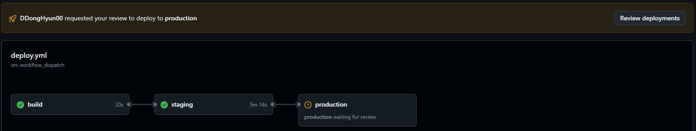
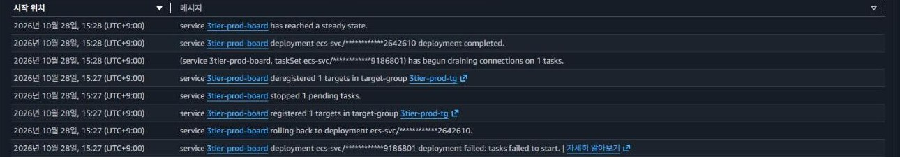
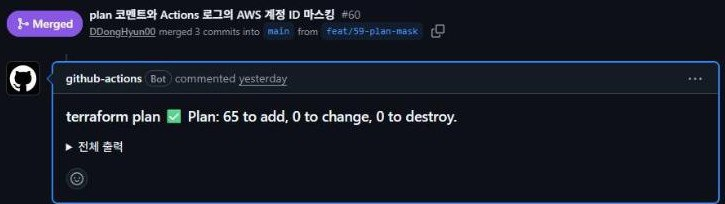
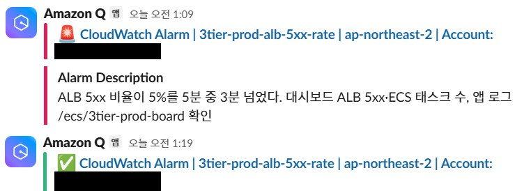
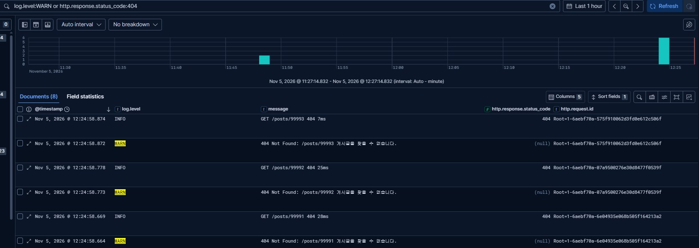

# 3-tier-terraform-ecs

**3계층 웹 서비스를 Terraform으로 구축하고, 장애 주입과 측정으로 가용성·관측성·비용을 개선한 기록입니다.**

Spring Boot 서비스를 AWS 3-Tier(ALB → ECS on EC2 → RDS)에 올리고, 배포 자동화·모니터링·중앙 로그·장애 실험·비용 최적화를 직접 만들었습니다. "구축했다"에서 멈추지 않고, 장애를 일부러 일으켜 **사용자 영향을 숫자로 재고 → 원인을 찾고 → 고치고 → 다시 재는** 순서로 진행했습니다.


## 핵심 결과

| 영역 | 결과 | 근거 |
|---|---|---|
| 재현성 | 리소스 148개를 **8분 51초**에 생성(접속 가능까지 9분 44초), **6분 51초**에 삭제. 모두 GitHub Actions에서 | [최종 재생성](docs/measurements.md#최종-재생성-2026-11-05), [#50](https://github.com/DDongHyun00/3-tier-terraform-ecs/issues/50) |
| 배포 | PR 머지 1번 → 빌드 → 스테이징 → 승인 → 운영 롤링. 수동 명령 13개를 대체 | [측정](docs/measurements.md#배포-소요-시간-2026-10-28) |
| 롤백 | 기동 실패 이미지를 서킷 브레이커가 **5분 19초** 만에 되돌림. 그동안 응답 217회 모두 200 | [02](docs/troubleshooting/02-bad-image-rollback.md) |
| 가용성 | 태스크 1개 강제 종료 사용자 영향 **0초**, RDS Multi-AZ 장애 조치 영향 **약 44초** | [01](docs/troubleshooting/01-task-killed.md), [06](docs/troubleshooting/06-rds-failover.md) |
| Spot 회수 | FIS로 회수 예고를 보내며 개선을 반복해 요청 실패 **13 → 18 → 12 → 0건** | [비용 10절](docs/cost.md#10-spot-용량-공급자와-관측-토글-e09-46), [DEC-67](docs/adr/0067-spot-capacity-mix.md) |
| 탐지 | CPU 과부하 알림 Grafana **4분 10초** vs CloudWatch 6분 26초. 1분 남짓 전체 중단은 Grafana만 잡음(약 50초) | [관측 비교](docs/monitoring.md) |
| 원인 추적 | DB 차단 장애에서 로그에 원인 줄이 **10.7초** 만에 남고, 같은 요청 ID로 500 응답까지 연결 | [중앙 로그](docs/logging.md) |
| 비용 | 쓰지 않을 때 destroy로 월 195 → 22.79 USD(**−88%**, 요금표 추정, v1 기준). Spot으로 컴퓨트 −15%, 관측 서버를 끈 세션 −34% | [비용 리포트](docs/cost.md) |

## 아키텍처


| 계층 | 구성 | 선택 이유 |
|---|---|---|
| 진입 | Route 53, ACM, ALB, CloudFront + S3 | HTTPS 종료와 정적 파일 분리 |
| 앱 | ECS on EC2(t3.small), 용량 공급자 2개(온디맨드 base 1 + Spot), AZ별 ASG | 호스트 수준 관측과 태스크·인스턴스 두 단계 스케일링 측정([DEC-36](docs/adr/0036-fargate-to-ecs-on-ec2.md)), Spot은 실패 0건 확인 후 채택([DEC-67](docs/adr/0067-spot-capacity-mix.md)) |
| 데이터 | RDS PostgreSQL, Secrets Manager | 외부 비공개, 비밀번호는 태스크에 주입. Multi-AZ는 장애 실험 때만 |
| 관제 | 별도 VPC의 Prometheus·Grafana, ELK, 피어링 | 운영과 장애 영역 분리([DEC-40](docs/adr/0040-three-vpcs-peering.md)). 관제가 죽어도 CloudWatch 비상 알람 2개는 남김 |
| 스테이징 | 운영과 같은 모듈을 작은 값으로 호출한 별도 루트(`terraform/staging`), 별도 VPC | 운영 배포 전 같은 이미지를 검증. 평소에는 내려 두고 배포 흐름 시험 때만 생성. 관제와 잇지 않고 배포 워크플로의 스모크 테스트(health·`/posts` 200)로 확인 |
| 배포 | GitHub Actions + OIDC, ECR, 스테이징 → 운영 승인 배포 | 액세스 키 0개, 배포 역할은 서비스별 최소 권한([DEC-24](docs/adr/0024-deploy-role-least-privilege.md)) |

설계 근거(CIDR·SG·IAM·태그 규칙, 요청·배포·알람 흐름)는 [docs/architecture.md](docs/architecture.md)에 있습니다.

## 핵심 장면

### 1. 장애를 일부러 일으키고, 고쳐서 실패 0건으로

Spot 인스턴스는 싸지만 AWS가 2분 예고 후 회수합니다. FIS로 회수 예고를 보내면서 설정을 하나씩 바꾸고 다시 쟀습니다. 원인은 마지막에 찾았습니다. 대체 태스크가 healthy가 될 때까지 옛 태스크를 붙잡는 최소 정상 비율 100%였습니다([비용 10절](docs/cost.md#spot-회수-측정-aws-fis), [DEC-67](docs/adr/0067-spot-capacity-mix.md)).


5회차(23:45:37 회수 예고)의 Grafana 화면입니다. 23:47 즈음 옛 Spot 태스크(파란 선)가 끝나고 새 태스크(노란 선)가 시작되는 동안에도 요청은 끊기지 않았습니다. 예고 뒤 요청 712건 중 실패 0건입니다.

### 2. 배포는 검증된 이미지만, 실패하면 자동으로 되돌린다



한 번 빌드한 이미지를 스테이징에서 검증한 뒤, 운영은 승인을 받아야 배포됩니다.



기동에 실패하는 이미지를 일부러 배포했습니다(아래에서 위로 읽음). 배포 실패 → 이전 버전으로 롤백 → 안정까지 5분 19초였고, 그동안 liveness 응답 217회가 모두 200이었습니다.

### 3. 인프라 변경도 코드 리뷰를 거친다



`terraform/**`를 바꾸는 PR에는 plan 결과가 코멘트로 달리고(계정 ID는 가림), 머지되면 운영에 apply됩니다. 액세스 키 없이 OIDC로 인증합니다.

### 4. 문제를 먼저 알고, 로그로 원인까지 찾는다



5xx 비율이 기준을 넘으면 Slack으로 알림이 오고, 해소되면 다시 알려 줍니다.



요청마다 ALB 추적 ID를 로그에 남겨, 같은 ID로 응답 로그(INFO)와 원인 로그(WARN)를 이어 봅니다.

## 장애 실험

모든 실험은 1초 간격 요청 기록([scripts/probe.ps1](scripts/probe.ps1))을 함께 돌려 사용자 영향을 쟀습니다.

| 실험 | 방법 | 사용자 영향 | 기록 |
|---|---|---|---|
| 태스크 강제 종료 | `ecs stop-task` 1개 / 2개 | 0초 / 68.8초(EC2 재측정, Fargate 때 46.5초) | [01](docs/troubleshooting/01-task-killed.md) |
| 잘못된 이미지 배포 | 기동 실패 이미지 머지 | 0건(자동 롤백 5분 19초) | [02](docs/troubleshooting/02-bad-image-rollback.md) |
| DB 연결 차단 | FIS 네트워크 차단 10분 | 약 10분(liveness는 정상, 재연결 1초 미만) | [03](docs/troubleshooting/03-db-connection-failure.md) |
| 컨테이너 인스턴스 종료 | ASG 인스턴스 종료 | 0초(ALB 5xx·연결 오류 기준, 관리형 드레이닝) | [04](docs/troubleshooting/04-instance-terminated.md) |
| RDS 장애 조치 | Multi-AZ 강제 장애 조치 | 약 44초 | [06](docs/troubleshooting/06-rds-failover.md) |
| Spot 회수 | FIS 회수 예고(2분) | 13건 → 개선 3번 → **0건** | [비용 10절](docs/cost.md#spot-회수-측정-aws-fis) |

실험 중 드러난 운영 문제도 같은 형식으로 남겼습니다(예: destroy 때 NAT가 먼저 지워져 서비스가 DRAINING에 멈춘 사고 [05](docs/troubleshooting/05-destroy-nat-order.md)).

## 실행 방법

1. `terraform/bootstrap`을 한 번 apply합니다(state 버킷, OIDC, 배포 역할, ECR, 호스팅 존). 값은 `terraform.tfvars.example`을 참고합니다.
2. 이후 인프라는 평소에는 GitHub Actions로 다루고, 장애 실험용 변수(예: RDS Multi-AZ, [06](docs/troubleshooting/06-rds-failover.md))만 로컬 apply로 줍니다.
   - `terraform/**`를 바꾼 PR: plan 결과가 코멘트로 달리고, 머지하면 운영에 apply됩니다.
   - 수동: Actions → `terraform` → `action=apply` 또는 `destroy`
   - 관측 서버 없이 띄우기: `enable_monitoring=false`, `enable_logging=false`
3. `app/**`를 바꾼 PR을 머지하면 이미지를 한 번 빌드해 스테이징 → (승인) → 운영 순서로 배포합니다.
4. 로컬 실행은 `docker compose up`(앱 + PostgreSQL). 앱 설명은 [app/README.md](app/README.md)에 있습니다.

## 폴더 구조

```
.
├── app/                  앱 (Spring Boot, Dockerfile)
├── docs/                 설계, 비용, 관측·로그 비교, 측정 상세, 장애 기록, ADR, 화면
├── load/                 k6 부하 시험
├── scripts/              장애 실험용 요청 기록(probe.ps1)
├── terraform/
│   ├── bootstrap/        최초 1회: state 버킷, OIDC, 배포 역할, ECR, Route 53, 예산, FIS 템플릿
│   ├── main/             운영: 반복 생성·삭제
│   ├── staging/          스테이징: 필요한 세션에만
│   └── modules/          network, data, compute, observability, monitoring, logging, vpc_peering
└── .github/workflows/    ci, deploy(스테이징 → 운영 승인), terraform, terraform-staging
```

## 문서

| 문서 | 내용 |
|---|---|
| [아키텍처 설계](docs/architecture.md) | CIDR·서브넷·SG·IAM·태그 규칙, 흐름도, 품질 목표치, 위험 |
| [측정 상세](docs/measurements.md) | 배포·롤백·부하·장애·EC2 전환 전후 측정표 |
| [비용 리포트](docs/cost.md) | 월 예상 비용, 실제 청구액, NAT 트레이드오프, Spot·관측 토글 |
| [관측 비교](docs/monitoring.md) | CloudWatch vs Prometheus·Grafana: 탐지 지연 실측, 비용 손익분기 |
| [중앙 로그](docs/logging.md) | 로그로 DB 장애 추적, ELK·Loki·CloudWatch Logs 비교 |
| [장애 기록](docs/troubleshooting/) | 증상 → 원인 → 조치 → 재발 방지 |
| [결정 기록(ADR)](docs/adr/) | 대표 결정 9건: 배경 → 선택지 → 결정 → 결과 |
| [프로젝트 히스토리 (Notion)](https://app.notion.com/p/3f4330bd3846812395f4d19208283e9c) | 에픽별 구축 기록, 결정 67건, 트러블슈팅, 실측 기록 DB |
| 작업 추적 | [Issues](https://github.com/DDongHyun00/3-tier-terraform-ecs/issues?q=is%3Aissue) · [Milestones](https://github.com/DDongHyun00/3-tier-terraform-ecs/milestones?state=closed) · [Project 보드](https://github.com/users/DDongHyun00/projects/11) |

## 진행 과정

| 에픽 | 내용 |
|---|---|
| E01~E02 | 앱 클라우드 대응(PostgreSQL, Flyway, 헬스체크, S3, 컨테이너), 설계 |
| E03~E05 | Terraform bootstrap, 네트워크·데이터, 컴퓨트·HTTPS |
| E06 | CI/CD(OIDC, 롤링 배포, plan 코멘트), 레포 보호 |
| E07~E08 | 오토스케일링·부하 시험, 장애 재현 |
| E10 | Fargate → ECS on EC2 전환과 전후 비교 |
| E11 | 관제 VPC, Prometheus·Grafana, 스테이징, 승인 배포 |
| E12 | 중앙 로그(구조화 로그, FireLens, Elasticsearch·Kibana) |
| E09 | 비용 분석(실제 청구액), Spot·관측 토글, 최종 재생성 측정 |

## 작업 방식

설계 결정과 장애 실험·측정은 직접 수행하고, AI는 코드 리뷰·검증과 실무 표준 확인에 활용했습니다.
