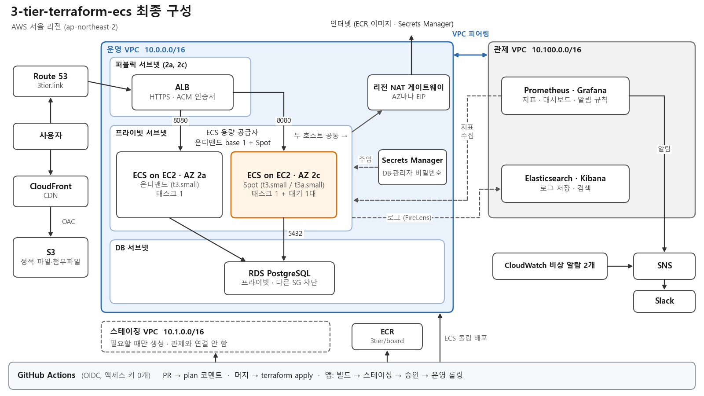
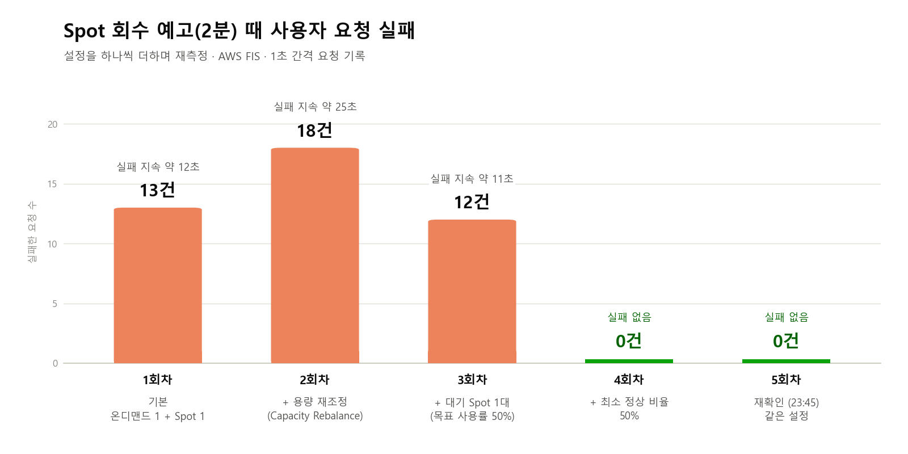

# 3-tier-terraform-ecs

**Spring Boot 웹 서비스를 AWS 3계층(ALB, ECS on EC2, RDS)에 Terraform으로 구축하고, 장애를 일부러 일으켜 사용자 영향을 재며 고친 프로젝트입니다.**

목표는 인프라를 띄우는 데서 끝내지 않고 실제로 운영할 수 있는 수준까지 만드는 것이었습니다. 배포 자동화, 모니터링, 중앙 로그, 보안, 비용 관리를 붙였고 설계 기준은 AWS Well-Architected의 보안, 복원력, 성능, 비용 최적화로 잡았습니다. 장애는 1초 간격 요청 기록을 켜 둔 채 주입해서, 사용자가 실제로 몇 초 동안 몇 건 실패했는지를 숫자로 남겼습니다.

> [!NOTE]
> **README는 요약입니다.** 숫자의 근거와 판단 과정은 [`docs/`](docs/) 폴더에 있습니다.
>
> - **설계** &nbsp; [아키텍처](docs/architecture.md), [설계 결정](docs/adr/)
> - **실측** &nbsp; [측정](docs/measurements.md), [장애 기록](docs/troubleshooting/), [비용](docs/cost.md)
> - **운영** &nbsp; [관측과 알림](docs/monitoring.md), [중앙 로그](docs/logging.md)

## 결과

| 영역 | 결과 | 근거 |
|---|---|---|
| 재현성 | 리소스 148개를 **8분 51초**에 생성하고 6분 51초에 삭제. 워크플로 시작부터 접속 가능까지 9분 44초 | [측정](docs/measurements.md) |
| 배포 | 명령 13개를 치던 배포를 PR 머지 한 번으로. 빌드, 스테이징 검증(떠 있을 때), 승인, 운영 롤링 순서 | [측정](docs/measurements.md) |
| 롤백 | 기동에 실패하는 이미지를 서킷 브레이커가 **5분 19초** 만에 되돌림. 그동안 liveness 응답 217회 모두 200 | [잘못된 이미지 배포](docs/troubleshooting/02-bad-image-rollback.md) |
| 가용성 | 태스크 1개 강제 종료 때 사용자 영향 0초, RDS Multi-AZ 장애 조치 때 약 44초 | [태스크 종료](docs/troubleshooting/01-task-killed.md), [RDS 장애 조치](docs/troubleshooting/06-rds-failover.md) |
| Spot 회수 | 설정을 하나씩 바꾸며 다시 재서 요청 실패 13건을 **0건**으로 | [Spot 회수](docs/troubleshooting/07-spot-interruption.md) |
| 탐지 | CPU 과부하 알림이 Grafana 4분 10초, CloudWatch 6분 26초. 약 65초 전체 중단은 Grafana만 약 50초에 잡음 | [관측과 알림](docs/monitoring.md) |
| 원인 추적 | DB 연결 차단 10.7초 뒤 원인 로그가 남고, 같은 요청 ID로 500 응답까지 이어짐 | [DB 연결 차단](docs/troubleshooting/03-db-connection-failure.md), [중앙 로그](docs/logging.md) |
| 비용 | 쓸 때만 켜서 월 195 USD를 22.79 USD로(**88%** 절감, 요금표 추정). Spot으로 컴퓨트 15%, 관측과 중앙 로그를 끈 세션 34% 절감 | [비용](docs/cost.md) |

## 아키텍처

그림을 누르면 원본 크기로 열립니다.

| 계층 | 구성 | 선택 이유 |
|---|---|---|
| 진입 | Route 53, ACM, ALB, CloudFront와 S3 | HTTPS 종료와 정적 파일 분리 |
| 앱 | ECS on EC2(t3.small), 용량 공급자 2개(온디맨드 1대 고정과 Spot), 가용 영역별 ASG | 호스트 수준 관측과 태스크, 인스턴스 두 단계 스케일링 |
| 데이터 | RDS PostgreSQL, Secrets Manager | 외부에 열지 않고, 비밀번호는 태스크에 주입. Multi-AZ는 장애 실험 때만 |
| 관제 | 별도 VPC의 Prometheus와 Grafana, ELK, VPC 피어링 | 운영과 장애 영역을 나눔. 관제가 죽어도 CloudWatch 비상 알람 2개는 남김 |
| 스테이징 | 운영과 같은 모듈을 작은 값으로 쓰는 별도 루트와 VPC | 운영 배포 전에 같은 이미지를 검증. 배포 흐름을 시험할 때만 생성 |
| 배포 | GitHub Actions와 OIDC, ECR | 액세스 키 없이 인증하고, 배포 역할은 서비스별 최소 권한 |

## 대표 사례

### 1. Spot 회수 실패를 0건으로

Spot 인스턴스는 싸지만 AWS가 2분 예고 뒤 회수합니다. AWS FIS로 회수 예고를 보내 보니 첫 회차에 요청 13건이 실패했습니다. 용량 재조정을 켜고, 대기 인스턴스를 1대 두어도 실패는 남았습니다. 마지막 원인은 최소 정상 비율 100%였습니다. ECS가 대체 태스크가 정상이 될 때까지 옛 태스크를 대상 그룹에 남겨 두는 사이 인스턴스가 회수됐습니다. 이 값을 50%로 낮추자 실패가 0건이 됐고, 같은 설정으로 한 번 더 잰 회차에서도 예고 뒤 요청 698건이 모두 성공했습니다.

대기 인스턴스가 Spot으로 아낀 비용의 절반 가까이를 다시 쓰는 건 감수했습니다. 다음에는 Spot 인스턴스 유형과 가용 영역을 넓히고, 회수 실험을 정기적으로 돌리려 합니다. 자세히: [Spot 회수](docs/troubleshooting/07-spot-interruption.md)

### 2. 승인 배포와 자동 롤백

`app/**`를 바꾼 PR을 머지하면 이미지를 한 번 빌드해 스테이징이 떠 있으면 먼저 배포하고 스모크 테스트를 합니다. 운영은 승인을 받아야 배포됩니다. `terraform/**`를 바꾼 PR에는 plan 결과가 코멘트로 달립니다. 운영에서만 기동에 실패하는 이미지를 일부러 배포했더니, 서킷 브레이커가 4분 5초 만에 실패로 판정하고 1분 14초 뒤 이전 버전으로 돌아왔습니다. 그동안 5초 간격 liveness 응답 217회는 모두 200이었습니다. 서비스 요청 전체는 재지 않았습니다.

이 실험은 일부러 운영에서 했습니다. 실무라면 스테이징에서 하고, 운영은 카나리 배포로 일부 트래픽에만 먼저 보내 영향 범위를 줄입니다. 자세히: [잘못된 이미지 배포](docs/troubleshooting/02-bad-image-rollback.md), [배포 측정](docs/adr/0025-deploy-rollback-measurement.md)

### 3. 장애를 먼저 알고 로그로 원인 찾기

장애 실험에서 탐지 공백이 두 번 드러났습니다. 태스크 2개가 같이 죽은 1분 남짓한 중단에 CloudWatch 알람은 울리지 않았고, DB 연결을 끊었을 때는 Grafana 규칙이 하나도 울리지 않았습니다. "수집되는 앱 태스크 0개" 규칙과 앱 5xx 비율 규칙을 Grafana에 넣어 메웠습니다. 원인 추적은 중앙 로그로 했습니다. 요청마다 ALB 추적 ID를 로그에 남겨, Kibana에서 500 응답과 같은 요청의 DB 연결 경고를 한 번에 이었습니다.

관제 서버는 1대라 죽으면 Grafana 알림이 멈춥니다. 그래서 독립 경로의 CloudWatch 비상 알람 2개를 남겼고, 관제 서버 자체의 상태 검사 알람이 다음 개선입니다. 자세히: [관측과 알림](docs/monitoring.md), [중앙 로그](docs/logging.md)

### 4. 필요할 때만 켜서 비용 88% 절감

개인 프로젝트라 늘 켜 둘 이유가 없었습니다. 처음 구성을 24시간 켜 두면 월 195 USD인데, 8시간 세션을 월 10번만 켜면 22.79 USD입니다. 그래서 평소에는 destroy해 두고 필요할 때 GitHub Actions로 다시 만듭니다. 대가는 세션마다 접속까지 9분 44초를 기다리는 것입니다. 켜 둔 동안에는 태스크 1개를 Spot에 두고, 측정이 없는 세션에는 관측 서버와 중앙 로그를 끄고 띄웠습니다. 실제 청구액에서 가장 큰 항목은 컴퓨트나 DB가 아닌 NAT 게이트웨이(37%)였습니다.

24시간 운영으로 바뀐다면 꾸준히 쓰는 컴퓨트에 Savings Plans를 걸고, AWS 서비스로 가는 트래픽은 VPC 엔드포인트로 돌려 NAT 비용을 줄이려 합니다. 자세히: [비용](docs/cost.md)

이 밖에 태스크 강제 종료, DB 연결 차단, 컨테이너 인스턴스 종료, RDS 장애 조치, destroy 순서 사고도 같은 형식으로 기록했습니다([장애 기록](docs/troubleshooting/)).

## 설계 결정

| 결정 | 이유 | 감수한 것 |
|---|---|---|
| [Fargate에서 ECS on EC2로 전환](docs/adr/0036-fargate-to-ecs-on-ec2.md) | CloudWatch의 ECS 지표가 약 4분 늦게 들어와 알람이 늦었습니다. 호스트 수집기로 15초마다 보려면 호스트가 필요했습니다. 비용 차이는 배포와 부하 시험을 한 번씩 한 8시간 세션에서 약 2%였습니다 | 인스턴스 패치, 드레이닝, 용량 공급자 관리. compute 모듈과 배포 권한을 다시 만들었습니다 |
| [배포 역할을 서비스별 최소 권한으로](docs/adr/0024-deploy-role-least-privilege.md) | AdministratorAccess를 떼고, CloudTrail 기록과 IAM Access Analyzer로 필요한 작업만 정책에 넣었습니다. 배포 역할이 스스로 권한을 키우지 못하게 permissions boundary와 명시적 Deny를 걸었습니다 | 이름 규칙(`3tier-prod-`)을 어기면 apply가 막힙니다. 처음 destroy가 빠진 권한 하나로 멈췄습니다 |
| [운영, 스테이징, 관제 VPC 분리](docs/adr/0040-three-vpcs-peering.md) | 관제가 죽어도 운영은 영향을 받지 않고, 피어링은 전이 라우팅을 하지 않아 운영과 스테이징이 저절로 격리됩니다. VPC 3개 규모에서는 Transit Gateway보다 피어링이 쌉니다 | VPC가 늘어 세션 비용이 늘었습니다. 스테이징은 관제와 잇지 않아 스모크 테스트로만 확인합니다 |

## 실행 방법

평소에는 비용 때문에 인프라를 내려 두어서 공개 URL은 없습니다. GitHub Actions로 apply하면 9분 44초 뒤에 접속할 수 있습니다.

사전 조건: AWS 계정, Route 53에 등록한 도메인, Terraform, Docker

1. `terraform/bootstrap`을 한 번 apply합니다. state 버킷, OIDC, 배포 역할, ECR, 호스팅 존을 만듭니다. 값은 `terraform.tfvars.example`을 참고합니다.
2. 인프라는 GitHub Actions로 다룹니다.
   - `terraform/**`를 바꾼 PR에는 plan 결과가 코멘트로 달리고, 머지하면 운영에 apply됩니다.
   - 직접 실행: Actions의 `terraform` 워크플로에서 `action=apply` 또는 `destroy`
   - 관측 서버 없이 띄우기: `enable_monitoring=false`, `enable_logging=false`
3. `app/**`를 바꾼 PR을 머지하면 스테이징(떠 있을 때), 승인, 운영 순서로 배포됩니다.
4. 로컬에서는 `docker compose up`으로 앱과 PostgreSQL을 띄웁니다. 앱 설명은 [app/README.md](app/README.md)에 있습니다.

폴더: `app/` 앱, `terraform/` bootstrap과 main, staging, modules, `.github/workflows/` CI와 배포, `docs/` 문서, `load/` 부하 시험, `scripts/` 요청 기록

## 한계와 개선 방향

| 한계 | 개선 방향 |
|---|---|
| 관제 서버가 1대라 죽으면 Grafana 알림이 모두 멈춥니다 | 관제 서버에 EC2 상태 검사 알람을 걸어 SNS로 보냅니다 |
| 로그 경로가 하나라 설정 실수로 로그가 10분 동안 사라졌습니다 | Fluent Bit으로 CloudWatch Logs와 Elasticsearch 두 곳에 보냅니다 |
| EC2로 바꾼 뒤 응답 p95가 30 ms에서 114 ms로 느려졌고 원인은 찾지 못했습니다 | 같은 조건으로 여러 번 재서 편차부터 확인합니다 |
| 부하를 집 PC에서 줬고 구성마다 한 번씩만 쟀습니다 | 같은 리전에서 부하를 주고 반복 측정합니다 |
| 오류 없이 느려지는 장애(RDS 장애 조치)는 5xx 알람으로 잡히지 않습니다 | 응답 시간 p95와 요청 수 급감, RDS 이벤트 구독으로 잡습니다 |

## 더 읽기

| 문서 | 볼 수 있는 것 |
|---|---|
| [아키텍처](docs/architecture.md) | 요청과 배포 흐름, CIDR와 Security Group, IAM, Terraform 구조, 설계 판단과 위험 |
| [장애 기록](docs/troubleshooting/) | 장애 7건의 재현 방법, 원인, 조치, 다시 잰 결과 |
| [측정](docs/measurements.md) | 품질 목표 대비 실측, 재생성, 배포, 롤백, 부하 시험, EC2 전환 전후 |
| [비용](docs/cost.md) | 시간당 비용, 줄인 방법, 비용보다 다른 것을 고른 곳, 실제 청구액 |
| [관측과 알림](docs/monitoring.md) | 알람과 규칙, CloudWatch와 Grafana 탐지 시간 비교, 비용 손익분기 |
| [중앙 로그](docs/logging.md) | 로그로 원인 찾기, ELK와 Loki, CloudWatch Logs 비교 |
| [설계 결정](docs/adr/) | 결정 9건의 배경, 선택지, 결정, 결과 |
