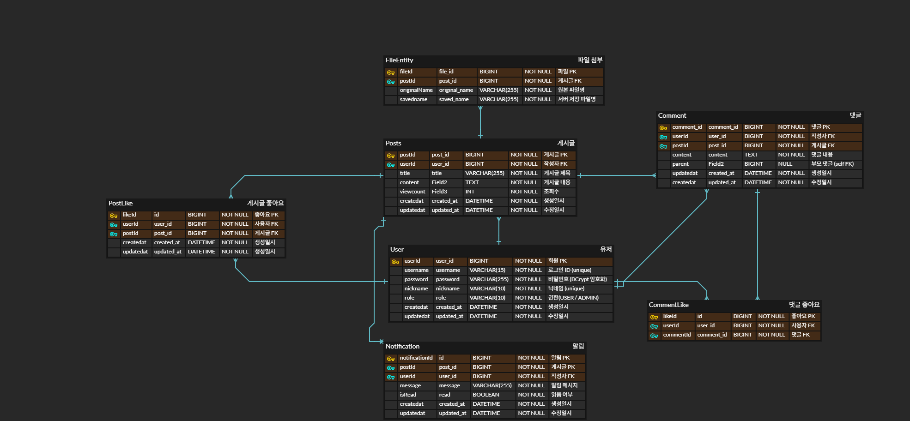

# 게시판

Spring Boot로 만든 게시판 서비스입니다. 회원가입과 로그인을 기반으로 게시글, 댓글, 좋아요, 알림, 파일 첨부 기능을 제공합니다.

## 주요 기능

- 회원가입, 로그인, 로그아웃 (Spring Security 폼 로그인, BCrypt)
- 게시글 작성, 조회, 수정, 삭제, 검색, 정렬, 페이지네이션
- 댓글과 대댓글
- 게시글과 댓글 좋아요
- 댓글과 좋아요 알림
- 파일 첨부와 다운로드
- 마이페이지 (내 알림, 활동 타임라인)
- 관리자 대시보드 (전체 통계, 당일 활동 현황)

## 기술 스택

- Java 17, Spring Boot 4.1
- Spring Data JPA, Spring Security, Thymeleaf
- PostgreSQL 16
- Gradle

## 실행

로컬 PostgreSQL을 Docker로 띄운 뒤 앱을 실행합니다.

```bash
docker run -d --name board-db -e POSTGRES_DB=board -e POSTGRES_USER=board -e POSTGRES_PASSWORD=board -p 5432:5432 postgres:16
./gradlew bootRun
```

실행 후 `http://localhost:8080` 으로 접속합니다.

DB 접속 정보는 환경 변수로 바꿀 수 있습니다. 지정하지 않으면 위 Docker 설정 기준의 기본값을 씁니다.

| 환경 변수 | 기본값 |
|---|---|
| `DB_URL` | `jdbc:postgresql://localhost:5432/board` |
| `DB_USERNAME` | `board` |
| `DB_PASSWORD` | `board` |

테스트(`./gradlew build`)는 Testcontainers로 PostgreSQL 컨테이너를 띄우므로 Docker가 실행 중이어야 합니다.

## 테스트 계정

| 아이디 | 비밀번호 | 닉네임 | 권한 |
|---|---|---|---|
| user1 | 1111 | 페브리즈 | USER |
| user2 | 1111 | 별빛소녀 | USER |
| user3 | 1111 | 감자탕매니아 | USER |
| user4 | 1111 | 책읽는고양이 | USER |
| admin | 1111 | 관리자 | ADMIN |

관리자 계정으로 로그인하면 상단 메뉴에 관리자 대시보드(`/admin/dashboard`)가 나타납니다.

---

## ERD

### 개요
- 주요 엔티티: User, Posts, Comment, PostLike, CommentLike, Notification, FileEntity
- 관계
  - 사용자(User)는 게시글(Posts), 댓글(Comment), 좋아요(PostLike, CommentLike), 알림(Notification)의 주체가 됨
  - 게시글은 파일(FileEntity), 댓글(Comment), 좋아요(PostLike), 알림(Notification)과 연결됨
  - 댓글은 자기참조(Self FK)를 통해 대댓글(Parent-Child 구조)을 지원함

관계 정리
- User (1) → (N) Posts: 사용자는 여러 게시글 작성 가능
- User (1) → (N) Comment: 사용자는 여러 댓글 작성 가능
- Post (1) → (N) Comment: 게시글에는 여러 댓글 존재 가능
- Comment (1) → (N) Comment(Self FK): 댓글은 대댓글 구조 지원
- Post (1) → (N) FileEntity: 게시글에는 여러 파일 첨부 가능
- Post (1) → (N) PostLike: 여러 사용자가 게시글 좋아요 가능
- Comment (1) → (N) CommentLike: 여러 사용자가 댓글 좋아요 가능
- User (1) → (N) Notification: 사용자는 여러 알림 수신 가능

---

### 다이어그램



---

### 테이블 정의

> 모든 엔티티는 `BaseTimeEntity`를 상속하며, 공통으로 `created_at`, `updated_at` 컬럼을 포함합니다.
> 
#### User (회원)
| 컬럼명 | 타입 | 제약조건 | 설명 |
|--------|------|----------|------|
| user_id | BIGINT | PK, NOT NULL | 회원 고유 ID |
| username | VARCHAR(15) | UNIQUE, NOT NULL | 로그인 ID |
| password | VARCHAR(255) | NOT NULL | 비밀번호 (BCrypt 해시) |
| nickname | VARCHAR(10) | UNIQUE, NOT NULL | 닉네임 |
| role | VARCHAR(10) | NOT NULL | 권한 (USER/ADMIN) |

#### Posts (게시글)
| 컬럼명 | 타입 | 제약조건 | 설명 |
|--------|------|----------|------|
| post_id | BIGINT | PK, NOT NULL | 게시글 ID |
| user_id | BIGINT | FK(User.user_id), NOT NULL | 작성자 |
| title | VARCHAR(255) | NOT NULL | 게시글 제목 |
| content | TEXT | NOT NULL | 게시글 내용 |
| viewcount | INT | NOT NULL | 조회수 |

#### Comment (댓글)
| 컬럼명 | 타입 | 제약조건 | 설명 |
|--------|------|----------|------|
| comment_id | BIGINT | PK, NOT NULL | 댓글 ID |
| user_id | BIGINT | FK(User.user_id), NOT NULL | 작성자 |
| post_id | BIGINT | FK(Posts.post_id), NOT NULL | 소속 게시글 |
| content | TEXT | NOT NULL | 댓글 내용 |
| parent | BIGINT | FK(Self.comment_id), NULL | 부모 댓글 ID (대댓글 구조) |


#### PostLike (게시글 좋아요)
| 컬럼명 | 타입 | 제약조건 | 설명 |
|--------|------|----------|------|
| like_id | BIGINT | PK, NOT NULL | 좋아요 ID |
| user_id | BIGINT | FK(User.user_id), NOT NULL | 좋아요 누른 사용자 |
| post_id | BIGINT | FK(Posts.post_id), NOT NULL | 대상 게시글 |


#### CommentLike (댓글 좋아요)
| 컬럼명 | 타입 | 제약조건 | 설명 |
|--------|------|----------|------|
| like_id | BIGINT | PK, NOT NULL | 좋아요 ID |
| user_id | BIGINT | FK(User.user_id), NOT NULL | 좋아요 누른 사용자 |
| comment_id | BIGINT | FK(Comment.comment_id), NOT NULL | 대상 댓글 |


#### Notification (알림)
| 컬럼명 | 타입 | 제약조건 | 설명 |
|--------|------|----------|------|
| notification_id | BIGINT | PK, NOT NULL | 알림 ID |
| post_id | BIGINT | FK(Posts.post_id), NOT NULL | 관련 게시글 |
| user_id | BIGINT | FK(User.user_id), NOT NULL | 알림 수신자 |
| message | VARCHAR(255) | NOT NULL | 알림 내용 |
| isRead | BOOLEAN | DEFAULT FALSE | 읽음 여부 |


#### FileEntity (파일 첨부)
| 컬럼명 | 타입 | 제약조건 | 설명 |
|--------|------|----------|------|
| file_id | BIGINT | PK, NOT NULL | 파일 ID |
| post_id | BIGINT | FK(Posts.post_id), NOT NULL | 소속 게시글 |
| original_name | VARCHAR(255) | NOT NULL | 원본 파일명 |
| saved_name | VARCHAR(255) | NOT NULL | 서버 저장 파일명 |

---

## 트랜잭션 관리
- 게시글 작성: Posts INSERT + FileEntity INSERT → 트랜잭션 처리
- 댓글 작성: Comment INSERT + Notification INSERT → 트랜잭션 처리
- 좋아요: Like INSERT + Notification INSERT → 트랜잭션 처리
- 실패 시 전체 롤백하여 데이터 무결성 보장

---

## 설계 포인트
- 정규화: 중복 최소화 및 무결성 유지
- 관계 무결성: FK 제약과 UNIQUE 인덱스로 데이터 일관성 보장
- 확장성: Notification 타입 컬럼을 두어 시스템 알림, 댓글 알림, 좋아요 알림 확장 가능
- 보안: User 비밀번호는 BCrypt 해시 처리
- 가독성: created_at / updated_at 컬럼을 모든 테이블에 포함해 변경 이력 추적 가능
- 사용자 경험: 마이페이지, 알림, 파일 첨부 기능 제공
- 운영 편의성: 관리자 대시보드 제공
