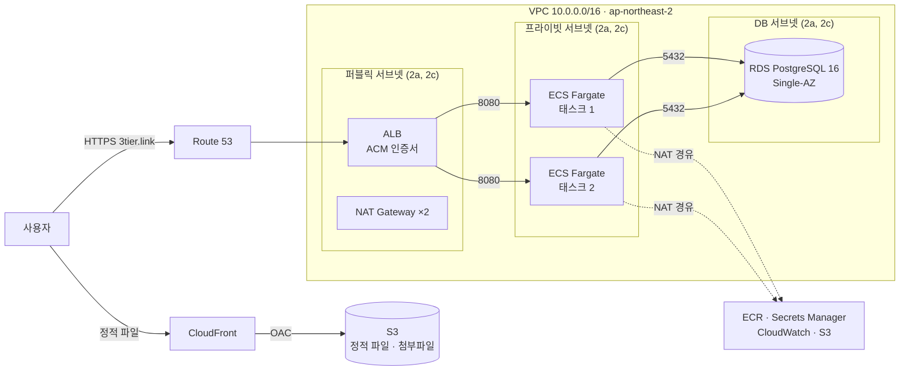
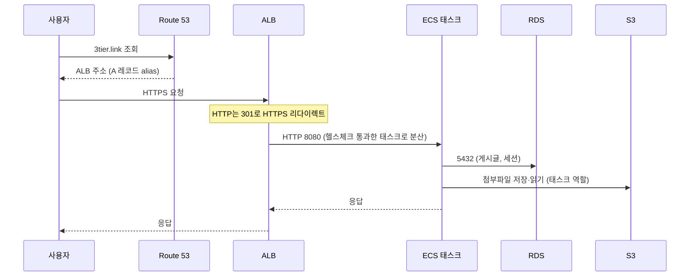
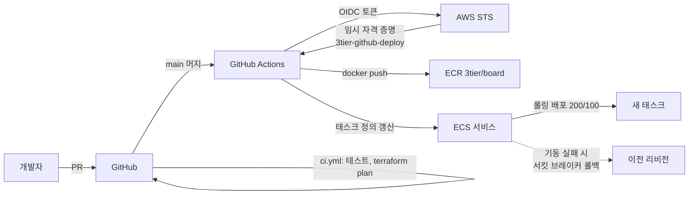
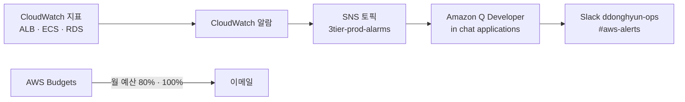

# 아키텍처 설계

Spring Boot 게시판을 AWS 3-Tier로 올리기 위한 설계 문서입니다. 15단계 이후의 Terraform 코드는 이 문서의 이름과 숫자를 그대로 씁니다. 설계 기준은 AWS Well-Architected의 보안, 복원력, 성능, 비용 최적화 네 영역입니다.

## 1. 전체 구조



| 계층 | 서브넷 | 들어 있는 것 | 외부 접근 |
|---|---|---|---|
| 진입 | 퍼블릭 | ALB, NAT Gateway | 인터넷에서 ALB 443/80만 |
| 앱 | 프라이빗 | ECS Fargate 태스크 | 불가. ALB를 통해서만 |
| 데이터 | DB | RDS | 불가. 앱 태스크에서만 |

세 계층을 서브넷과 Security Group으로 나누는 것이 3-Tier의 핵심입니다. DB는 퍼블릭 IP도 없고 인터넷으로 나가는 경로도 없습니다.

앱이 서버 렌더링(Thymeleaf)이어도 3-Tier입니다. 계층은 "어느 서브넷에 있고 누가 누구에게 접근할 수 있나"로 나누는 네트워크와 접근 통제의 단위이고, HTML을 서버에서 만드는지 브라우저에서 만드는지는 앱 설계의 문제입니다. 전통적인 3-Tier가 바로 웹 서버 + Java 앱 서버 + DB였습니다. 여기서는 전통적인 웹 서버 자리를 ALB가 맡고, 웹 서버가 하던 정적 파일 서빙은 CloudFront + S3로 분리합니다.

## 2. 요청 흐름



- 세션은 RDS의 `SPRING_SESSION` 테이블에 있으므로 어느 태스크가 받아도 로그인이 유지됩니다.
- ALB 헬스체크는 `/actuator/health/liveness`입니다. DB가 끊겨도 200을 돌려주므로 DB 장애 때 태스크가 불필요하게 교체되지 않습니다. DB 장애는 RDS 알람이 잡습니다.

## 3. 배포 흐름



- 액세스 키 없음. GitHub Actions는 OIDC 토큰으로 IAM 역할을 수임하고, 역할의 신뢰 조건은 이 레포의 `main` 브랜치와 PR로 제한합니다.
- `main`은 직접 push하지 않고 PR로만 바꾸는 것을 운영 원칙으로 둡니다. PR 본문은 `.github/pull_request_template.md`(목표·변경·검증·Closes #) 틀을 따릅니다.
- 브랜치 보호 규칙은 현재 적용하지 않습니다. 프라이빗 레포의 현재 플랜에서는 ruleset을 만들 수 없어서, 적용할 내용(PR 필수, `app-test`·`terraform-plan` 상태 체크 필수, 강제 push·삭제 금지)을 `.github/rulesets/main.json`에 정의만 해 두었습니다. 레포를 공개하는 시점에 적용 여부를 다시 검토합니다. 경로 필터로 건너뛴 잡은 성공으로 집계되므로, 적용하더라도 앱만 바뀐 PR이 막히지는 않습니다.
- 롤링 배포는 최소 100%, 최대 200%입니다. 태스크 2개 기준으로 새 태스크 2개를 먼저 띄우고 헬스체크를 통과하면 이전 태스크를 내립니다. 배포 중에도 서비스 용량이 줄지 않습니다.
- 새 태스크가 기동에 반복 실패하면 ECS 배포 서킷 브레이커가 이전 태스크 정의로 자동 롤백합니다.

## 4. 알람 흐름



## 5. 네트워크 설계

### 5.1 CIDR와 서브넷

| 이름 | CIDR | AZ | 용도 | 퍼블릭 IP 자동 할당 |
|---|---|---|---|---|
| `3tier-prod-vpc` | 10.0.0.0/16 | | VPC | |
| `3tier-prod-public-a` | 10.0.0.0/24 | ap-northeast-2a | ALB, NAT | 예 |
| `3tier-prod-public-c` | 10.0.1.0/24 | ap-northeast-2c | ALB, NAT | 예 |
| `3tier-prod-private-a` | 10.0.10.0/24 | ap-northeast-2a | ECS 태스크 | 아니오 |
| `3tier-prod-private-c` | 10.0.11.0/24 | ap-northeast-2c | ECS 태스크 | 아니오 |
| `3tier-prod-db-a` | 10.0.20.0/24 | ap-northeast-2a | RDS | 아니오 |
| `3tier-prod-db-c` | 10.0.21.0/24 | ap-northeast-2c | RDS (서브넷 그룹용) | 아니오 |

설계 이유:

- **/16 VPC, /24 서브넷**: /24는 IP 251개(AWS 예약 5개 제외)로 태스크 수십 개까지 여유가 있고, /16 안에 /24가 256개 들어가므로 계층을 추가해도 번호가 겹치지 않습니다. 0번대는 퍼블릭, 10번대는 프라이빗, 20번대는 DB로 두 번째 옥텟만 보고 계층을 알 수 있게 했습니다.
- **AZ 2곳 (2a, 2c)**: 서울 리전의 AZ 4곳(2a~2d) 모두 Fargate와 db.t4g.micro를 지원함을 확인했습니다(2026-10-07). 2a와 2c는 서울에서 가장 먼저 생긴 AZ라 신규 서비스 지원이 가장 빠르고, 국내 자료에서 가장 흔히 쓰는 조합이라 골랐습니다. 두 AZ 사이 지연은 1ms 안팎이라 성능 차이는 없습니다.
- **DB 서브넷이 2개인 이유**: RDS 서브넷 그룹이 최소 2개 AZ를 요구합니다. Single-AZ라도 2개가 필요하고, 나중에 Multi-AZ를 켜면 2c에 대기 인스턴스가 생깁니다.

### 5.2 라우팅

| 라우트 테이블 | 연결 서브넷 | 0.0.0.0/0 → | 비고 |
|---|---|---|---|
| `3tier-prod-rt-public` | public-a, public-c | 인터넷 게이트웨이 | |
| `3tier-prod-rt-private-a` | private-a | NAT Gateway (2a) | AZ별 NAT. 2c 장애 시 2a 태스크는 영향 없음 |
| `3tier-prod-rt-private-c` | private-c | NAT Gateway (2c) | |
| `3tier-prod-rt-db` | db-a, db-c | 없음 | 외부로 나가는 경로 자체가 없음 |

- **NAT Gateway 2개**: 기획서의 "다중 AZ 가용성" 기준. 하나만 두면 그 AZ 장애 시 다른 AZ의 태스크도 ECR 풀과 Secrets 조회가 막혀 재배포가 불가능해집니다. 비용은 시간당 약 0.12달러로 전체의 40% 이상이며, 이 트레이드오프는 비용 리포트에 기록합니다.
- 프라이빗 서브넷에서 NAT를 거쳐 나가는 트래픽은 ECR 이미지 풀, Secrets Manager, CloudWatch Logs, S3입니다. 인바운드는 ALB를 통해서만 들어옵니다.

### 5.3 Security Group

규칙은 아래 표에 있는 것만 허용하고 나머지는 모두 차단합니다. SG는 상태 저장이므로 인바운드로 들어온 연결의 응답은 별도 규칙 없이 나갑니다.

| SG | 인바운드 | 아웃바운드 |
|---|---|---|
| `3tier-prod-sg-alb` | 443 ← 0.0.0.0/0, 80 ← 0.0.0.0/0 | 8080 → sg-app |
| `3tier-prod-sg-app` | 8080 ← sg-alb | 5432 → sg-db, 443 → 0.0.0.0/0 |
| `3tier-prod-sg-db` | 5432 ← sg-app | 없음 |

- 소스를 CIDR이 아니라 **SG 참조**로 적습니다. 태스크 IP는 재배포마다 바뀌지만 SG는 바뀌지 않습니다.
- app의 아웃바운드 443은 NAT를 통한 AWS API 호출(ECR, Secrets Manager, CloudWatch, S3)용입니다. AWS API는 모두 443이므로 포트를 이것으로 좁힙니다.
- db의 아웃바운드는 비워 둡니다. DB가 먼저 연결을 시작할 일이 없습니다.
- 80은 HTTPS 리다이렉트를 위해서만 열고, ALB 리스너가 301로 돌려보냅니다.

## 6. 컴퓨트와 데이터

### 6.1 ECS

| 항목 | 값 | 이유 |
|---|---|---|
| 클러스터 | `3tier-prod-cluster` | Container Insights 켬 |
| 태스크 CPU / 메모리 | 0.5 vCPU / 1 GB | 처음엔 0.25 vCPU / 0.5 GB로 잡았으나 AWS에서 기동 120초, 첫 응답 수 초라 올림. 기동 23초로 단축 (E05) |
| 원하는 태스크 수 | 2 | AZ마다 1개. 1개면 재배포·장애 시 다운타임 |
| 오토스케일링 | 최소 2, 최대 4, 목표 CPU 60% | 20단계에서 부하 테스트로 검증 |
| 배포 | 롤링, 최소 100% / 최대 200%, 서킷 브레이커 + 롤백 | 무중단 배포, 실패 시 자동 복구 |
| 로그 | CloudWatch Logs `/ecs/3tier-prod-board`, 보존 7일 | 비용. 장애 기록은 문서로 남김 |
| 헬스체크 | ALB: `/actuator/health/liveness`, 15초 간격, 정상 2회 / 비정상 2회 | DB와 무관한 경로 |
| stopTimeout | 30초 | 앱의 graceful 유예 20초보다 길게 |

태스크에 주입하는 설정:

| 변수 | 출처 | 값 |
|---|---|---|
| `DB_URL` | 환경 변수 | `jdbc:postgresql://<RDS 엔드포인트>:5432/board` |
| `DB_USERNAME`, `DB_PASSWORD` | Secrets Manager → `secrets` 항목 | 실행 역할이 읽어 주입. 태스크 정의에 평문 없음 |
| `STORAGE_TYPE` | 환경 변수 | `s3` |
| `S3_BUCKET` | 환경 변수 | 첨부파일 버킷 이름 |
| `AWS_REGION` | 환경 변수 | `ap-northeast-2` |

### 6.2 RDS

| 항목 | 값 | 이유 |
|---|---|---|
| 식별자 | `3tier-prod-db` | |
| 엔진 | PostgreSQL 16.15 (서울 리전 최신 16.x, 2026-10-07 확인) | 앱 8단계에서 16으로 확정. 마이너는 Terraform에서 `auto_minor_version_upgrade`로 자동 반영 |
| 클래스 | db.t4g.micro | 비용. ARM(Graviton)이 같은 급 x86보다 쌈 |
| 스토리지 | gp3 20 GB | 최소 크기 |
| Multi-AZ | 변수 `multi_az`, 기본 false | 평소 꺼 두고 장애 재현 때만 켬 |
| 퍼블릭 접근 | 불가 | DB 서브넷 + sg-db |
| 백업 보존 | 1일 | 반복 destroy 전제. 운영이면 7일 이상 |
| 삭제 보호 | 끔 | 반복 destroy 전제 |
| 비밀번호 | Terraform `random_password` → Secrets Manager `3tier-prod-db-credentials` | 코드에 평문 없음. state 파일에는 남으므로 state 버킷 접근 제한이 곧 비밀번호 보호 |

### 6.3 S3와 CloudFront

| 항목 | 값 |
|---|---|
| 버킷 | `3tier-assets-<계정ID 뒤 4자리>` (전역 유일 이름) |
| 퍼블릭 액세스 | 4개 항목 모두 차단 |
| 암호화 | SSE-S3 |
| 접근 | 앱 태스크 역할(첨부파일 읽기·쓰기), CloudFront OAC(정적 파일 읽기) |
| CloudFront | 오리진 S3, OAC로 버킷 직접 접근 차단, 정적 파일(`/static/*`) 서빙 |

첨부파일 다운로드는 앱이 권한을 확인한 뒤 S3에서 읽어 내려주므로 CloudFront를 거치지 않습니다. CloudFront는 정적 파일(CSS)만 담당합니다.

## 7. IAM

### 7.1 사람과 자동화의 인증

| 주체 | 인증 방식 | 영구 키 |
|---|---|---|
| 개발자 (콘솔, 로컬 Terraform) | IAM Identity Center `3tier-admin` + MFA, CLI 프로필 `3tier` (SSO) | 없음 |
| GitHub Actions | OIDC 토큰 → 역할 `3tier-github-deploy` 수임 | 없음 |
| ECS 태스크 | 태스크 역할 `3tier-ecs-task` | 없음 |

계정 안에 영구 액세스 키를 쓰는 주체가 없습니다.

### 7.2 역할

| 역할 | 누가 수임 | 권한 | 최소 권한 근거 |
|---|---|---|---|
| `3tier-github-deploy` | GitHub Actions (OIDC) | 고객 관리형 정책 5개(`terraform/bootstrap/deploy_policies.tf`). **state-ecr**: state 버킷의 `main/` 객체 읽기·쓰기·삭제(잠금 파일 포함), ECR `3tier/board` push. **network**: EC2(VPC, 서브넷, IGW, EIP, NAT, 라우트, SG) 생성·변경, 삭제는 `Project` 태그가 붙은 것만. **compute**: ECS, ELB, CloudWatch Logs `/ecs/3tier-prod-*`, ACM, Route 53(호스팅 존 1개), IAM 역할·정책 `3tier-prod-*`, PassRole `3tier-prod-*`(ECS 태스크에만). **data**: RDS `db-3tier-prod*`, Secrets Manager `3tier-prod-*`, KMS(Secrets Manager·RDS 경유만), S3 `3tier-assets-*` 버킷 1개, CloudFront. **observability**: Application Auto Scaling, CloudWatch 알람·대시보드 `3tier-prod-*`, SNS `3tier-prod-*` | 신뢰 조건을 `repo:DDongHyun00@<owner_id>/3-tier-terraform-ecs@<repo_id>:ref:refs/heads/main`과 PR로 제한(2026-07 이후 레포는 sub에 불변 ID 포함). 다른 레포·브랜치는 수임 불가. 권한은 AdministratorAccess로 시작해(DEC-21) CloudTrail 호출 기록과 코드로 좁혔다(#35). 리소스는 이름·ARN(리전·계정·리소스 종류)으로 좁혔고, 이름이 없는 EC2 리소스의 삭제는 태그로 좁혔다. 역할 생성·정책 부여는 permissions boundary `3tier-ecs-boundary`가 붙은 역할에만 허용해, 어떤 정책을 넣어도 ECS 역할의 실제 권한은 boundary 안에 머문다. 이 역할 자신(`3tier-github-deploy`), 그 정책(`3tier-github-deploy*`), boundary 정책은 명시적 Deny로 수정·삭제·태그·신뢰 정책 변경을 막았다 |
| (boundary) `3tier-ecs-boundary` | — | ECR 이미지 풀, 로그 스트림 쓰기 `/ecs/3tier-prod-*`, 시크릿 `3tier-prod-*` 읽기, assets 버킷 객체 읽기·쓰기 | 아래 두 ECS 역할의 권한 상한. 배포 역할이 역할에 정책을 넣을 수 있어도 이 범위를 넘지 못한다 |
| `3tier-ecs-task-execution` | ECS 에이전트 | `AmazonECSTaskExecutionRolePolicy` + Secrets Manager 시크릿 1개 `GetSecretValue` | 이미지 풀, 로그 쓰기, 시크릿 주입에 필요한 것만. boundary `3tier-ecs-boundary` |
| `3tier-ecs-task` | 앱 컨테이너 | S3 버킷 1개 `GetObject`, `PutObject` | 앱이 AWS에 하는 일은 첨부파일 읽기·쓰기뿐. boundary `3tier-ecs-boundary` |

실행 역할과 태스크 역할을 나누는 이유: 실행 역할은 컨테이너를 띄우는 ECS의 권한이고, 태스크 역할은 컨테이너 안 코드의 권한입니다. 앱이 시크릿을 직접 읽을 필요가 없으므로 태스크 역할에는 Secrets Manager 권한을 주지 않습니다.

## 8. Terraform 구조

```
terraform/
├── bootstrap/        최초 1회 생성 후 유지. 로컬에서 apply
│   ├── state 버킷 (3tier-tfstate-<계정ID 뒤 4자리>, 버전 관리, SSE, 퍼블릭 차단)
│   ├── GitHub OIDC Provider + 역할 3tier-github-deploy
│   ├── ECR 3tier/board (태그 불변, 스캔, 수명 주기)
│   └── Route 53 호스팅 존 참조 (data 소스. 존은 도메인 구매 시 자동 생성됨)
├── main/             반복 생성·삭제. 로컬 또는 GitHub Actions에서 apply
│   └── modules 호출, 변수(multi_az 등), 출력(ALB DNS, RDS 엔드포인트)
└── modules/
    ├── network/      VPC, 서브넷, IGW, NAT, 라우트, SG
    ├── data/         RDS, Secrets Manager, S3, CloudFront
    ├── compute/      ECS, ALB, ACM, Route 53 레코드, IAM 역할
    └── observability/ CloudWatch 대시보드·알람, SNS, 오토스케일링
```

- 원격 state는 S3, 잠금은 S3 네이티브 잠금(`use_lockfile = true`, Terraform 1.11+). bootstrap과 main은 같은 버킷의 다른 키를 씁니다.
- bootstrap을 분리한 이유: main을 매일 destroy해도 state 버킷, 배포 역할, 이미지 저장소, 호스팅 존은 남아야 합니다.

## 9. 이름과 태그 규칙

| 대상 | 규칙 | 예 |
|---|---|---|
| main 리소스 | `3tier-prod-<리소스>` | `3tier-prod-vpc`, `3tier-prod-alb`, `3tier-prod-cluster` |
| 첫 글자가 영문이어야 하는 RDS 계열 이름 (식별자, 서브넷 그룹) | `db-3tier-prod-*`. 태그 Name은 규칙대로 | `db-3tier-prod`, `db-3tier-prod-subnets` |
| bootstrap 리소스, IAM 역할 | `3tier-<리소스>` (환경 하나를 공유) | `3tier-github-deploy`, `3tier-ecs-task` |
| S3 버킷 | `3tier-<용도>-<계정ID 뒤 4자리>` (전역 유일) | `3tier-tfstate-xxxx`, `3tier-assets-xxxx` |
| ECR | `3tier/board` | |

태그는 provider `default_tags`로 모든 리소스에 자동 적용합니다.

| 키 | 값 |
|---|---|
| `Project` | `3-tier-terraform-ecs` |
| `Env` | `prod` |
| `Owner` | `DDongHyun00` |

태그는 22단계에서 Cost Explorer로 비용을 나누는 기준이고, 다음 FinOps 프로젝트의 입력 데이터입니다.

## 10. 비용 구조 (서울 리전 온디맨드, 2026-10 기준 추정)

| 리소스 | 시간당 (USD) | 비중 | 비고 |
|---|---|---|---|
| NAT Gateway ×2 | 0.128 | 약 48% | 기획서의 다중 AZ 기준. EIP 퍼블릭 IPv4 요금 포함. 1개로 줄이면 절반 |
| ALB | 0.04 | 약 15% | 퍼블릭 IPv4 2개 요금 포함 |
| Fargate ×2 (0.5 vCPU / 1 GB) | 0.057 | 약 22% | 스케일 아웃 시 비례 증가 |
| RDS db.t4g.micro + 20 GB | 0.03 | 약 11% | Multi-AZ 켜면 인스턴스 2배 |
| 기타 (Secrets, 로그, 알람, Route 53, CloudFront, S3) | 약 0.01 | 약 4% | 대부분 월 고정 |
| 합계 | 약 0.265 | | 하루 24시간 약 6.4달러, 8시간 세션 약 2.1달러 |

- 평소에는 main을 destroy해 두고 bootstrap만 유지합니다. bootstrap 유지 비용은 월 1달러 미만입니다.
- 정확한 수치는 22단계에서 실제 청구액으로 갱신합니다.

## 11. 설계 판단 요약

| 판단 | 선택 | 이유 |
|---|---|---|
| 컴퓨트 | ECS Fargate | 서버 관리 없음. EKS는 제어 플레인만 월 73달러이고 일주일 범위에 과함 |
| DB 배치 | DB 서브넷, 외부 경로 없음 | 보안 영역의 기본. 접근은 sg-app에서만 |
| DB 가용성 | Single-AZ, Multi-AZ는 변수 | 비용. 장애 재현 때 켜서 장애 조치 시간을 측정 |
| NAT | AZ별 2개 | 기획서의 다중 AZ 기준. 비용 트레이드오프는 리포트에 기록 |
| 배포 인증 | GitHub OIDC | 액세스 키 없음. 역할 신뢰 조건으로 레포·브랜치 제한 |
| 사람 인증 | IAM Identity Center + MFA | 계정에 영구 키 0개 |
| 세션 | Spring Session JDBC (RDS) | 태스크 간 로그인 공유. Redis는 인프라 추가라 범위 밖 |
| 스키마 | Flyway | 태스크 동시 기동 시 잠금으로 한 번만 적용. ddl-auto는 운영 부적합 |
| 헬스체크 | liveness (DB 제외) | DB 장애 때 태스크 교체 루프 방지 |
| 정적 파일 | S3 + CloudFront | 기획서 기준 |
| state 잠금 | S3 네이티브 | 1.11부터 정식. DynamoDB 방식은 폐기 예정 |
