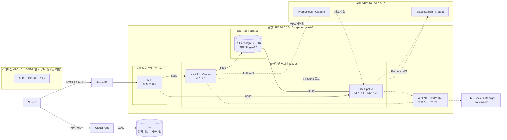
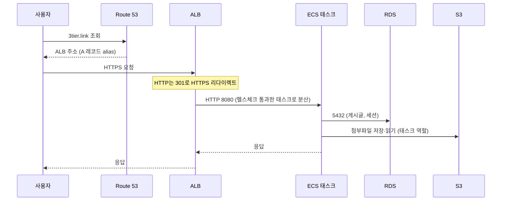
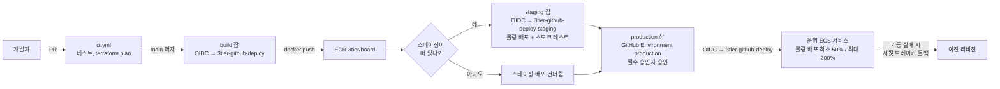
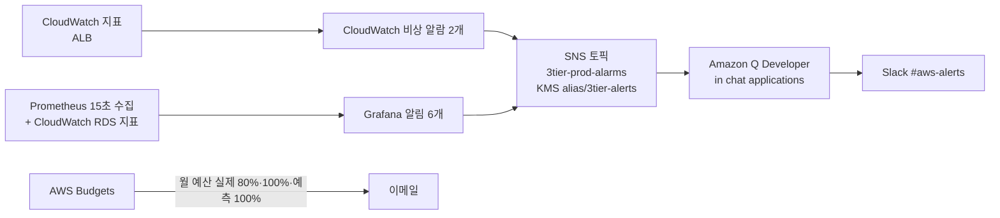

# 아키텍처 설계

Spring Boot 게시판을 AWS 3-Tier로 올리기 위한 설계 문서입니다. Terraform 코드(E03 이후)는 이 문서의 이름과 숫자를 그대로 씁니다. 설계 기준은 AWS Well-Architected의 보안, 복원력, 성능, 비용 최적화 네 영역이고, 설계 요구사항으로 다중 AZ 가용성(AZ 하나가 죽어도 서비스와 재배포가 이어짐), HTTPS, 정적 파일 분리, 영구 액세스 키 0개를 두었습니다. 대표 결정은 [ADR](adr/)에 있습니다.

## 1. 전체 구조



| 계층 | 서브넷 | 들어 있는 것 | 외부 접근 |
|---|---|---|---|
| 진입 | 퍼블릭 | ALB | 인터넷에서 ALB 443/80만 |
| 앱 | 프라이빗 | ECS 태스크(EC2 컨테이너 인스턴스 위, awsvpc) | 불가. ALB를 통해서만 |
| 데이터 | DB | RDS | 불가. 앱 태스크에서만 |

세 계층을 서브넷과 Security Group으로 나누는 것이 3-Tier의 핵심입니다. DB는 퍼블릭 IP도 없고 인터넷으로 나가는 경로도 없습니다.

앱이 서버 렌더링(Thymeleaf)이어도 3-Tier입니다. 계층은 "어느 서브넷에 있고 누가 누구에게 접근할 수 있나"로 나누는 네트워크와 접근 통제의 단위이고, HTML을 서버에서 만드는지 브라우저에서 만드는지는 앱 설계의 문제입니다. 전통적인 3-Tier가 바로 웹 서버 + Java 앱 서버 + DB였습니다. 여기서는 전통적인 웹 서버 자리를 ALB가 맡고, 웹 서버가 하던 정적 파일 서빙은 CloudFront + S3로 분리합니다.

## 2. 요청 흐름



- 세션은 RDS의 `SPRING_SESSION` 테이블에 있으므로 어느 태스크가 받아도 로그인이 유지됩니다.
- ALB 헬스체크는 `/actuator/health/liveness`입니다. DB가 끊겨도 200을 돌려주므로 DB 장애 때 태스크가 불필요하게 교체되지 않습니다. DB 연결 장애는 ALB 5xx 비율 알람과 Grafana AppHttp5xxRate가 잡습니다.

## 3. 배포 흐름



- 액세스 키 없음. GitHub Actions는 OIDC 토큰으로 IAM 역할을 수임합니다. 운영 역할 `3tier-github-deploy`의 신뢰 조건은 이 레포의 `main` 브랜치(`ref:refs/heads/main`), PR(`pull_request`), GitHub Environment `production`(`environment:production`)이고, 스테이징 역할 `3tier-github-deploy-staging`은 Environment `staging`(`environment:staging`)만 수임할 수 있습니다(`terraform/bootstrap/oidc.tf`).
- 스테이징이 내려가 있으면 스테이징 배포와 스모크 테스트(health·`/posts` 200)는 건너뛰고 운영 승인 단계로 갑니다.
- `main`은 직접 push하지 않고 PR로만 바꾸는 것을 운영 원칙으로 둡니다. PR 본문은 `.github/pull_request_template.md`(목표·변경·검증·Closes #) 틀을 따릅니다.
- 레포는 2026-11-05에 공개로 바꿨습니다. 운영 배포는 GitHub Environment `production`의 필수 승인자를 거칩니다. 비공개 레포에서는 필수 승인자를 쓸 수 없어 공개 뒤 켰습니다.
- 브랜치 보호 ruleset은 적용할 내용(PR 필수, `app-test`·`terraform-plan` 상태 체크 필수, 강제 push·삭제 금지)을 `.github/rulesets/main.json`에 정의만 두었고, 적용은 레포 설정에서 합니다. 경로 필터로 건너뛴 잡은 성공으로 집계되므로, 적용하더라도 앱만 바뀐 PR이 막히지는 않습니다.
- 롤링 배포는 최소 50%, 최대 200%입니다. 태스크 2개 기준으로 새 태스크를 띄우면서 이전 태스크를 1개까지 먼저 내릴 수 있습니다. 처음에는 최소 100%였으나, Spot 회수 때 옛 태스크를 바로 빼야 회수 전에 요청을 다른 태스크로 넘길 수 있어 50%로 낮췄습니다([DEC-67](adr/0067-spot-capacity-mix.md)). 대가로 배포·회수 때 1~2분 동안 태스크가 1개입니다.
- 새 태스크가 기동에 반복 실패하면 ECS 배포 서킷 브레이커가 이전 태스크 정의로 자동 롤백합니다.

## 4. 알람 흐름



CloudWatch에는 관제 서버가 죽어도 오는 비상 알람 2개와 자동 확장 알람(목표 추적이 만드는 것)만 남겼습니다. ECS CPU·RDS 스토리지·RDS 연결 알람과 CloudWatch 대시보드는 #95 실측 뒤 Grafana로 옮기고 지웠습니다.

| 알람 | 조건 |
|---|---|
| `3tier-prod-alb-5xx-rate` | (ALB 5xx + 앱 5xx) / 요청 > 5%, 5분 중 3분. 분당 요청 10건 미만은 0으로 계산 |
| `3tier-prod-alb-unhealthy-targets` | 비정상 타깃 ≥ 1, 2분 연속 |

- 울릴 때와 복구될 때 모두 Slack으로 보내도록 구성했습니다.
- 알람은 main(매 세션 생성·삭제)에, SNS 토픽·KMS 키·Q Developer 채널 설정은 bootstrap(상시)에 두었습니다. Q Developer는 채널 설정을 만들 때 토픽에 구독을 겁니다. 토픽을 main에 두면 destroy 때 구독이 사라지고 다시 apply해도 되살아나지 않습니다.
- 토픽은 고객 관리형 KMS 키로 암호화했습니다. CloudWatch 알람은 AWS 관리형 키(aws/sns)로 암호화된 토픽에는 발행하지 못하므로, 키 정책에서 이 계정의 알람(`aws:SourceAccount`, `aws:SourceArn`)에만 데이터 키 사용을 허용했습니다. 키 로테이션도 켰습니다.
- Q Developer API는 서울 리전에 없어서 채널 설정은 us-east-2에 두고 서울 토픽을 연결했습니다. 채널 가드레일은 기본값(AdministratorAccess) 대신 CloudWatchReadOnlyAccess로 제한했습니다.

**Grafana 알림(E11 #95)**: 관제 Prometheus가 15초마다 수집하고 Grafana가 10초마다 규칙을 평가합니다(Grafana 스케줄러 기본 간격 10초의 배수만 허용). 알림은 Grafana SNS 연락처 → 같은 알람 토픽 → Amazon Q Developer → Slack으로, CloudWatch 알람과 경로를 공유합니다. Q Developer는 사용자 정의 알림 형식(`version 1.0`, `source custom`, `content.description`)만 Slack에 올리므로 Grafana 메시지 템플릿이 그 JSON을 만듭니다.

| 규칙 | 식 | 기준 | 심각도 |
|---|---|---|---|
| AppCpuWarning | 앱 컨테이너 평균 CPU(예약 0.5 vCPU 대비 %, cAdvisor) | 60% 초과 3분 | warning |
| AppCpuCritical | 같음 | 80% 초과 3분 | critical |
| AppNoScrapeTarget | 지표를 내는 앱 태스크 수 | 1 미만 30초 | critical |
| AppHttp5xxRate | 앱 5xx 비율(http_server_requests, 1분 rate). 분당 요청 10건 미만이면 0 | 5% 초과 1분 | critical |
| RdsStorageLow | RDS FreeStorageSpace(CloudWatch 데이터 소스, 5분 최솟값) | 2 GB 미만 | critical |
| RdsConnectionsHigh | RDS DatabaseConnections(CloudWatch 데이터 소스, 1분 최댓값) | 60 초과 3분 | warning |

앱 규칙은 10초마다, RDS 규칙은 지표가 1~5분 단위라 1분마다 평가합니다.

AppHttp5xxRate는 #100 DB 연결 장애에서 Grafana 규칙이 하나도 울리지 않은 공백을 메우려고 더했습니다(#131). 시험에서 500 발생 1분 27.7초 뒤 SNS로 발송됐습니다.

**중앙 로그(E12)**: 앱은 Elastic Common Schema JSON으로 로그를 내고(Spring Boot 구조화 로그), 요청마다 ALB `X-Amzn-Trace-Id`를 `http.request.id`로 붙입니다. 앱 태스크의 FireLens 사이드카(aws-for-fluent-bit)가 관제 VPC의 Elasticsearch(`app-board-YYYY.MM.DD`)로 보내고, Kibana는 SSM 포트 포워딩으로만 엽니다. Fluent Bit 계정은 이 인덱스에 쓰기만 합니다. 앱 로그는 CloudWatch Logs로 가지 않고, 라우터 자신의 로그만 갑니다(`enable_logging=false`면 앱 로그가 CloudWatch Logs로 갑니다). 장애 추적 기록과 로그 스택 비교는 [logging.md](logging.md)에 있습니다.

AppNoScrapeTarget은 E08에서 태스크 2개 동시 종료(46.5~68.8초 중단) 때 CloudWatch 알람이 울리지 않은 탐지 공백을 메우려는 규칙입니다. 11/04 같은 장애(약 65초 중단)에서 Grafana는 중단 약 50초 뒤 Slack에 알렸고 CloudWatch 알람은 이번에도 울리지 않았습니다. 같은 CPU 부하에서는 Grafana 경고가 4분 10초, CloudWatch CPU 알람이 6분 26초였습니다([monitoring.md](monitoring.md)).

## 5. 네트워크 설계

### 5.1 CIDR와 서브넷

| 이름 | CIDR | AZ | 용도 | 퍼블릭 IP 자동 할당 |
|---|---|---|---|---|
| `3tier-prod-vpc` | 10.0.0.0/16 | | VPC | |
| `3tier-prod-public-a` | 10.0.0.0/24 | ap-northeast-2a | ALB | 예 |
| `3tier-prod-public-c` | 10.0.1.0/24 | ap-northeast-2c | ALB | 예 |
| `3tier-prod-private-a` | 10.0.10.0/24 | ap-northeast-2a | ECS 태스크 | 아니오 |
| `3tier-prod-private-c` | 10.0.11.0/24 | ap-northeast-2c | ECS 태스크 | 아니오 |
| `3tier-prod-db-a` | 10.0.20.0/24 | ap-northeast-2a | RDS | 아니오 |
| `3tier-prod-db-c` | 10.0.21.0/24 | ap-northeast-2c | RDS (서브넷 그룹용) | 아니오 |

설계 이유:

- **/16 VPC, /24 서브넷**: /24는 IP 251개(AWS 예약 5개 제외)로 태스크 수십 개까지 여유가 있고, /16 안에 /24가 256개 들어가므로 계층을 추가해도 번호가 겹치지 않습니다. 0번대는 퍼블릭, 10번대는 프라이빗, 20번대는 DB로 두 번째 옥텟만 보고 계층을 알 수 있게 했습니다.
- **AZ 2곳 (2a, 2c)**: 서울 리전의 AZ 4곳(2a~2d) 모두 Fargate와 db.t4g.micro를 지원함을 확인했습니다(2026-10-07). 2a와 2c는 서울에서 가장 먼저 생긴 AZ라 신규 서비스 지원이 가장 빠르고, 국내 자료에서 가장 흔히 쓰는 조합이라 골랐습니다. 두 AZ 사이 지연은 1ms 안팎이라 성능 차이는 없습니다.
- **DB 서브넷이 2개인 이유**: RDS 서브넷 그룹이 최소 2개 AZ를 요구합니다. Single-AZ라도 2개가 필요하고, Multi-AZ를 켜면 주 DB가 없는 쪽 AZ에 대기 인스턴스가 생깁니다(#82 실측 때는 주 2c, 대기 2a).

**관제 VPC(E11, [DEC-40](adr/0040-three-vpcs-peering.md))**: Prometheus·Grafana(#92)와 ELK(E12)가 들어가는 공용 서비스 VPC입니다. 같은 network 모듈로 만들고 main에 두어 세션마다 생성·삭제합니다. 스테이징 VPC는 10.1.0.0/16으로 별도 루트(`terraform/staging`)에서 필요할 때만 만듭니다.

| 이름 | CIDR | AZ | 용도 |
|---|---|---|---|
| `3tier-prod-mon-vpc` | 10.100.0.0/16 | | 관제 VPC |
| `3tier-prod-mon-public-a` | 10.100.0.0/24 | ap-northeast-2a | 영역 NAT 자리만. 인바운드 입구(ALB·공인 IP 인스턴스)는 없음 |
| `3tier-prod-mon-private-a` / `-c` | 10.100.10.0/24, 10.100.11.0/24 | 2a, 2c | 관제 서버 |

### 5.2 라우팅

| 라우트 테이블 | 연결 서브넷 | 0.0.0.0/0 → | 비고 |
|---|---|---|---|
| `3tier-prod-rt-public` | public-a, public-c | 인터넷 게이트웨이 | |
| `3tier-prod-rt-private-a` | private-a | 리전 NAT `3tier-prod-nat` | 10.100.0.0/16 → 관제 피어링, S3 → 게이트웨이 엔드포인트 |
| `3tier-prod-rt-private-c` | private-c | 리전 NAT `3tier-prod-nat`(같은 ID) | 같음 |
| `3tier-prod-rt-db` | db-a, db-c | 없음 | 외부로 나가는 경로 자체가 없음. 피어링 경로도 넣지 않음 |
| `3tier-prod-mon-rt-private-a` / `-c` | 관제 private | 영역 NAT `3tier-prod-mon-nat-a` | 10.0.0.0/16 → 운영 피어링, S3 → 게이트웨이 엔드포인트 |

- **운영 NAT: 리전 NAT 게이트웨이 수동 모드(E11)**: NAT ID 하나가 2a·2c에 EIP를 하나씩 두고 동작합니다. 설계 요구사항인 다중 AZ 가용성은 그대로라 한 AZ가 죽어도 다른 AZ 태스크의 ECR 풀과 Secrets 조회가 살아 있습니다. 영역 NAT 2개(E04~E10)와 비용은 같고(AZ당 시간 요금), 사설 라우트 테이블이 같은 NAT ID를 가리켜 AZ를 늘려도 경로를 고칠 일이 없습니다. NAT가 퍼블릭 서브넷에 살 필요가 없어 퍼블릭 서브넷에는 ALB만 남습니다. 자동 모드는 새 AZ로 펼쳐지는 데 최대 60분이 걸려 AZ를 직접 지정하는 수동 모드를 썼습니다([리전 NAT](https://docs.aws.amazon.com/vpc/latest/userguide/nat-gateways-regional.html)).
- **관제 NAT: 영역 NAT 1개**: 관제는 세션용이라 NAT AZ(2a) 장애 때 2c 서버의 아웃바운드가 끊기는 것을 감수했습니다.
- **피어링([DEC-40](adr/0040-three-vpcs-peering.md))**: 관제 ↔ 운영 1개(`3tier-prod-pcx-mon-prod`), 같은 계정·리전이라 요청과 동시에 수락합니다. 피어링은 전이 라우팅을 하지 않아 관제 ↔ 스테이징을 따로 만들면 운영 ↔ 스테이징은 자동으로 막힙니다. 관제 ↔ 스테이징은 처음 설계에는 있었지만 만들지 않았습니다. 스테이징 루트(#101)에 피어링이 없어 스테이징은 관제 서버가 보지 않고, 스테이징 확인은 배포 워크플로의 스모크 테스트(health·`/posts` 200)로 합니다.
- **S3 게이트웨이 엔드포인트**: 세 VPC 모두 사설 라우트 테이블에 답니다. ECR 이미지 레이어(S3)가 NAT를 거치지 않고, 추가 요금이 없습니다. 피어링으로는 다른 VPC의 엔드포인트를 빌려 쓸 수 없어 VPC마다 둡니다.
- 프라이빗 서브넷에서 NAT를 거쳐 나가는 트래픽은 ECR API, Secrets Manager, CloudWatch Logs 같은 AWS API 호출입니다. S3(첨부파일, ECR 이미지 레이어)는 NAT가 아니라 S3 게이트웨이 엔드포인트로 갑니다. 인바운드는 ALB를 통해서만 들어옵니다.

### 5.3 Security Group

규칙은 아래 표에 있는 것만 허용하고 나머지는 모두 차단합니다. SG는 상태 저장이므로 인바운드로 들어온 연결의 응답은 별도 규칙 없이 나갑니다.

| SG | 인바운드 | 아웃바운드 |
|---|---|---|
| `3tier-prod-sg-alb` | 443 ← 0.0.0.0/0, 80 ← 0.0.0.0/0 | 8080 → sg-app |
| `3tier-prod-sg-app` | 8080 ← sg-alb, 8080 ← `3tier-prod-mon-sg-prometheus`(E11) | 5432 → sg-db, 443 → 0.0.0.0/0, 9200 → `3tier-prod-mon-sg-elk`(E12) |
| `3tier-prod-sg-db` | 5432 ← sg-app | 없음 |

- 소스를 CIDR이 아니라 **SG 참조**로 적습니다. 태스크 IP는 재배포마다 바뀌지만 SG는 바뀌지 않습니다.
- app의 아웃바운드 443은 AWS API 호출(ECR, Secrets Manager, CloudWatch는 NAT 경유, S3는 게이트웨이 엔드포인트 경유)용입니다. AWS API는 모두 443이므로 포트를 이것으로 좁힙니다.
- app의 8080 ← Prometheus SG와 9200 → ELK SG는 관제·로그 모듈이 만드는 규칙입니다(`terraform/modules/monitoring/main.tf`, `terraform/modules/logging/main.tf`). 9200은 FireLens 사이드카가 앱 태스크 ENI로 관제 VPC Elasticsearch에 로그를 보내는 경로이고, ELK SG는 9200을 app SG에서만 받습니다.
- **관제 수집 규칙(E11 #91)**: 관제 VPC의 `3tier-prod-mon-sg-prometheus`는 인바운드가 없고(접속은 SSM 포트 포워딩), 아웃바운드는 운영 컨테이너 인스턴스 SG의 9100(node_exporter)·8081(cAdvisor), app SG의 8080(`/actuator/prometheus`), 그리고 443(이미지·패키지·AWS API)만 엽니다. 대상 쪽(인스턴스 SG·app SG)은 그 포트를 Prometheus SG 참조로만 엽니다. 피어링된 같은 리전 VPC끼리는 SG를 서로 참조할 수 있어 IP 대역 대신 SG로 좁혔습니다.
- **앱 지표 경로(E11 #94)**: `/actuator/prometheus`는 세 겹으로 막습니다. ① ALB HTTPS 리스너 규칙(우선순위 10)이 404를 돌려주고, ② 앱이 `X-Forwarded-For`가 붙은 요청(ALB를 거친 요청에는 ALB가 항상 붙임)을 거부하며, ③ 앱 SG가 8080을 ALB와 관제 Prometheus에만 엽니다. ②가 있어 앱 배포가 ALB 규칙보다 먼저 끝나도 공개되지 않습니다. Prometheus는 피어링으로 태스크 8080에 직접 붙고, 태스크 IP는 Cloud Map 비공개 DNS `board.3tier-prod.internal`(A 레코드, ECS가 등록·해제)로 찾습니다. 비공개 존은 연결된 VPC에서만 풀리고 피어링은 DNS를 넘겨주지 않아, 존에 관제 VPC를 따로 연결했습니다.
- db의 아웃바운드는 비워 둡니다. DB가 먼저 연결을 시작할 일이 없습니다.
- 80은 HTTPS 리다이렉트를 위해서만 열고, ALB 리스너가 301로 돌려보냅니다.

## 6. 컴퓨트와 데이터

### 6.1 ECS

| 항목 | 값 | 이유 |
|---|---|---|
| 클러스터 | `3tier-prod-cluster` | Container Insights 켬 |
| 용량 | 용량 공급자 2개. `3tier-prod-ec2` → ASG `3tier-prod-ecs-asg`(온디맨드, 2a 서브넷, 최소 1·상한 8대), `3tier-prod-spot` → ASG `3tier-prod-ecs-spot-asg`(Spot, 2c 서브넷, t3.small·t3a.small, `price-capacity-optimized`, 용량 재조정 켬, 상한 8대). 서비스 전략은 온디맨드 `base=1, weight=0` + Spot `weight=1`. 인스턴스는 t3.small, CPU 크레딧 unlimited | 호스트에 에이전트(node_exporter·cAdvisor·Fluent Bit)를 올리고 태스크·인스턴스 두 단계 스케일링을 재기 위해 Fargate에서 전환했습니다([DEC-36](adr/0036-fargate-to-ecs-on-ec2.md), #87). Fargate 구성은 git 태그 `v1-fargate`. 온디맨드 1대가 태스크 1개를 늘 받치고 나머지는 Spot에 둡니다([DEC-67](adr/0067-spot-capacity-mix.md)). Spot 용량 공급자는 관리형 스케일링 목표 사용률 50%라 Spot 태스크 1개당 빈 인스턴스 1대를 대기로 두고, 회수 예고(2분) 때 바로 옮깁니다([cost.md](cost.md) 10절). 상한 8은 태스크 상한 4의 2배: 인스턴스당 태스크 1개(t3.small 2 GiB에 1 GiB 태스크)라 배포가 태스크 4개 상태에서도 멈추지 않게 한 여유입니다. `enable_spot=false`면 온디맨드 ASG가 두 AZ를 쓰고 최소 2대입니다 |
| 인스턴스 | ECS 최적화 Amazon Linux 2023(공개 SSM 파라미터로 최신 조회), gp3 30 GB 암호화, IMDSv2만, SSM으로만 접속(SSH 키 없음) | 영구 키 0개 원칙([DEC-14](adr/0014-identity-center-mfa.md)) |
| 배치 | AZ 분산 → 메모리 binpack. 관리형 스케일링(온디맨드 목표 100%, Spot 50%)·관리형 종료 보호·관리형 드레이닝 | t3.small은 네트워크 인터페이스(ENI) 3개라 awsvpc 태스크가 인스턴스당 최대 2개, 메모리상 1 GB 태스크는 1개 |
| 태스크 CPU / 메모리 | 0.5 vCPU / 1 GB | 처음엔 0.25 vCPU / 0.5 GB로 잡았으나 AWS에서 기동 120초, 첫 응답 수 초라 올림. 기동 23초로 단축 (E05) |
| 원하는 태스크 수 | 2 | AZ마다 1개. 1개면 재배포·장애 시 다운타임 |
| 오토스케일링 | 최소 2, 최대 4, 목표 추적 CPU 60%, 늘림 쿨다운 60초·줄임 쿨다운 300초 | 서비스 desired_count는 Terraform이 무시합니다(오토스케일링 값을 apply가 되돌리지 않게). #40 부하 테스트로 검증 |
| 배포 | 롤링, 최소 50% / 최대 200%, 서킷 브레이커 + 롤백 | Spot 회수 때 옛 태스크를 바로 빼도록 최소를 50%로 둠([DEC-67](adr/0067-spot-capacity-mix.md)). 실패 시 자동 복구 |
| 로그 | `enable_logging=true`(기본): FireLens(Fluent Bit 사이드카) → 관제 VPC Elasticsearch, CloudWatch Logs에는 로그 라우터 자신의 로그만. `false`: 앱 로그가 CloudWatch Logs `/ecs/3tier-prod-board`, 보존 7일 | 중앙 로그는 4절 끝과 [logging.md](logging.md) |
| 헬스체크 | ALB: `/actuator/health/liveness`, 15초 간격, 정상 2회 / 비정상 2회 | DB와 무관한 경로 |
| stopTimeout | 30초 | 앱의 graceful 유예 20초보다 길게 |

태스크에 주입하는 설정:

| 변수 | 출처 | 값 |
|---|---|---|
| `DB_URL` | 환경 변수 | `jdbc:postgresql://<RDS 엔드포인트>:5432/board` |
| `DB_USERNAME`, `DB_PASSWORD` | Secrets Manager → `secrets` 항목 | 실행 역할이 읽어 주입. 태스크 정의에 평문 없음 |
| `ADMIN_PASSWORD` | Secrets Manager → `secrets` 항목 | 같은 DB 비밀의 `admin_password` 키. 앱이 기동할 때 시드 admin 비밀번호를 이 값으로 바꿈 |
| `STORAGE_TYPE` | 환경 변수 | `s3` |
| `S3_BUCKET` | 환경 변수 | 첨부파일 버킷 이름 |
| `AWS_REGION` | 환경 변수 | `ap-northeast-2` |

### 6.2 RDS

| 항목 | 값 | 이유 |
|---|---|---|
| 식별자 | `db-3tier-prod` | RDS 식별자는 첫 글자가 영문이어야 해서 `db-` 접두사. 태그 Name은 `3tier-prod-db` |
| 엔진 | PostgreSQL 16.15 (서울 리전 최신 16.x, 2026-10-07 확인) | 앱 준비(E01)에서 16으로 확정. 마이너는 Terraform에서 `auto_minor_version_upgrade`로 자동 반영 |
| 클래스 | db.t4g.micro | 비용. ARM(Graviton)이 같은 급 x86보다 쌈 |
| 스토리지 | gp3 20 GB | 최소 크기 |
| Multi-AZ | 변수 `multi_az`, 기본 false | 변수로 켤 수 있게 두었습니다. [#82](https://github.com/DDongHyun00/3-tier-terraform-ecs/issues/82)에서 잠시 켜고 강제 장애 조치: 장애 조치 43초, 사용자 영향 약 44초, 5xx 0건([06-rds-failover.md](troubleshooting/06-rds-failover.md)) |
| 퍼블릭 접근 | 불가 | DB 서브넷 + sg-db |
| 백업 보존 | 1일 | 반복 destroy 전제. 운영이면 7일 이상 |
| 삭제 보호 | 끔 | 반복 destroy 전제 |
| 비밀번호 | Terraform `random_password` → Secrets Manager `3tier-prod-db-credentials`(키 `username`·`password`·`admin_password`) | 코드에 평문 없음. state 파일에는 남으므로 state 버킷 접근 제한이 곧 비밀번호 보호 |

### 6.3 S3와 CloudFront

| 항목 | 값 |
|---|---|
| 버킷 | `3tier-assets-<계정ID 뒤 4자리>` (전역 유일 이름) |
| 퍼블릭 액세스 | 4개 항목 모두 차단 |
| 암호화 | SSE-S3 |
| 접근 | 앱 태스크 역할(첨부파일 읽기·쓰기), CloudFront OAC(정적 파일 읽기) |
| CloudFront | 오리진 S3, OAC로 버킷 직접 접근 차단, 정적 파일(`/static/*`) 서빙 |

첨부파일 다운로드는 앱이 권한을 확인한 뒤 S3에서 읽어 내려주므로 CloudFront를 거치지 않습니다. CloudFront는 정적 파일(CSS)만 담당합니다.

## 7. IAM

### 7.1 사람과 자동화의 인증

| 주체 | 인증 방식 | 영구 키 |
|---|---|---|
| 개발자 (콘솔, 로컬 Terraform) | IAM Identity Center `3tier-admin` + MFA, CLI 프로필 `3tier` (SSO) | 없음 |
| GitHub Actions | OIDC 토큰 → 역할 `3tier-github-deploy`(운영), `3tier-github-deploy-staging`(스테이징) 수임 | 없음 |
| ECS 태스크 | 태스크 역할 `3tier-prod-ecs-task` | 없음 |
| EC2 컨테이너 인스턴스 | 인스턴스 프로필 `3tier-prod-ecs-instance` | 없음 |

계정 안에 영구 액세스 키를 쓰는 주체가 없습니다.

### 7.2 역할

| 역할 | 누가 수임 | 권한 | 최소 권한 근거 |
|---|---|---|---|
| `3tier-github-deploy` | GitHub Actions (OIDC) | 고객 관리형 정책 7개(`terraform/bootstrap/deploy_policies.tf`, 스테이징 배포 역할도 같은 문서를 이름 접두사만 바꿔 씀). **state-ecr**: state 버킷의 `main/` 객체 읽기·쓰기·삭제(잠금 파일 포함), ECR `3tier/board` push. **network**: EC2(VPC, 서브넷, IGW, EIP, NAT, 라우트, SG) 생성·변경, 삭제는 `Project` 태그가 붙은 것만. **compute**: ECS, ELB, CloudWatch Logs `/ecs/3tier-prod-*`, ACM, Route 53(호스팅 존 1개), IAM 역할·정책 `3tier-prod-*`, PassRole `3tier-prod-*`(ECS 태스크에만). **data**: RDS `db-3tier-prod*`, Secrets Manager `3tier-prod-*`, KMS(Secrets Manager·RDS 경유만), S3 `3tier-assets-*` 버킷 1개, CloudFront. **observability**: Application Auto Scaling, CloudWatch 알람·대시보드 `3tier-prod-*`, SNS `3tier-prod-*`(알람 토픽을 이름으로 찾는 `ListTopics` 포함). **compute-ec2**: 시작 템플릿·ASG·인스턴스 프로필·AMI 조회(compute 정책이 관리형 정책 크기 한도를 넘어 분리). **network-e11**: 관제 VPC 피어링, S3 게이트웨이 엔드포인트, Cloud Map, ALB 리스너 규칙 등 E11 추가분 | 신뢰 조건(sub)을 `repo:DDongHyun00@<owner_id>/3-tier-terraform-ecs@<repo_id>:` 뒤에 `ref:refs/heads/main`(build·apply), `pull_request`(plan), `environment:production`(승인 뒤 운영 배포)만 허용하도록 제한(2026-07 이후 레포는 sub에 불변 ID 포함). 스테이징 역할 `3tier-github-deploy-staging`은 `environment:staging`만 허용합니다. 다른 레포·브랜치는 수임 불가. 권한은 AdministratorAccess로 시작해 CloudTrail 호출 기록과 코드로 좁혔습니다(#35, [DEC-24](adr/0024-deploy-role-least-privilege.md)). 리소스는 이름·ARN(리전·계정·리소스 종류)으로 좁혔고, 이름이 없는 EC2 리소스의 삭제는 태그로 좁혔습니다. 역할 생성·정책 부여는 permissions boundary `3tier-ecs-boundary`가 붙은 역할에만 허용해, 어떤 정책을 넣어도 ECS 역할의 실제 권한은 boundary 안에 머뭅니다. 이 역할 자신(`3tier-github-deploy`), 그 정책(`3tier-github-deploy*`), boundary 정책은 명시적 Deny로 수정·삭제·태그·신뢰 정책 변경을 막았습니다 |
| (boundary) `3tier-ecs-boundary` | — | ECR 이미지 풀, 로그 스트림 쓰기 `/ecs/3tier-prod-*`, 시크릿 `3tier-prod-*` 읽기, assets 버킷 객체 읽기·쓰기 | 아래 ECS 역할들의 권한 상한. 배포 역할이 역할에 정책을 넣을 수 있어도 이 범위를 넘지 못합니다 |
| `3tier-prod-ecs-task-execution` | ECS(태스크 실행) | `AmazonECSTaskExecutionRolePolicy` + DB 비밀 `3tier-prod-db-credentials` `GetSecretValue`. `enable_logging=true`면 Fluent Bit 계정 비밀(Elasticsearch) `GetSecretValue`도 추가(`terraform/modules/compute/logs.tf`) | 이미지 풀, 로그 쓰기, 시크릿 주입에 필요한 것만. boundary `3tier-ecs-boundary` |
| `3tier-prod-ecs-task` | 앱 컨테이너 | S3 버킷 1개 `GetObject`, `PutObject` | 앱이 AWS에 하는 일은 첨부파일 읽기·쓰기뿐. boundary `3tier-ecs-boundary` |
| `3tier-prod-ecs-instance` | EC2 컨테이너 인스턴스(ECS 에이전트) | `AmazonEC2ContainerServiceforEC2Role` + `AmazonSSMManagedInstanceCore` | 클러스터 등록·태스크 상태 보고와 SSM 접속만. boundary `3tier-ecs-boundary` |

실행 역할과 태스크 역할을 나누는 이유: 실행 역할은 컨테이너를 띄우는 ECS의 권한이고, 태스크 역할은 컨테이너 안 코드의 권한입니다. 앱이 시크릿을 직접 읽을 필요가 없으므로 태스크 역할에는 Secrets Manager 권한을 주지 않습니다.

## 8. Terraform 구조

```
terraform/
├── bootstrap/        최초 1회 생성 후 유지. 로컬에서 apply
│   ├── state 버킷 (3tier-tfstate-<계정ID 뒤 4자리>, 버전 관리, SSE, 퍼블릭 차단)
│   ├── GitHub OIDC Provider + 역할 3tier-github-deploy(운영)·3tier-github-deploy-staging(스테이징)
│   ├── 배포 역할 고객 관리형 정책과 permissions boundary (운영·스테이징)
│   ├── ECR 3tier/board (태그 불변, 스캔, 수명 주기)
│   ├── Route 53 호스팅 존 참조 (data 소스. 존은 도메인 구매 시 자동 생성됨)
│   ├── 알람 알림 경로: SNS 토픽 3tier-prod-alarms + KMS 키 + Q Developer Slack 채널 설정·역할 3tier-chatbot
│   ├── AWS Budgets 월 예산과 알림
│   ├── AWS FIS 실험 템플릿(DB 연결 장애, Spot 회수)과 실험 역할
│   └── 서비스 연결 역할(리전 NAT 게이트웨이)
├── main/             운영·관제 VPC. 반복 생성·삭제. GitHub Actions(terraform.yml)에서 apply
│   └── modules 호출, 변수(multi_az 등), 출력(ALB DNS, RDS 엔드포인트)
├── staging/          스테이징 VPC. 별도 state, 필요할 때만 생성(terraform-staging.yml)
└── modules/
    ├── network/      VPC, 서브넷, IGW, NAT(리전·영역), 라우트, S3 게이트웨이 엔드포인트, SG. 운영·관제·스테이징에 재사용
    ├── vpc_peering/  피어링 1개와 양쪽 사설 경로
    ├── data/         RDS, Secrets Manager, S3, CloudFront
    ├── compute/      ECS(EC2 용량 공급자·ASG), ALB, ACM, Route 53 레코드, Cloud Map, FireLens, IAM 역할
    ├── observability/ CloudWatch 비상 알람 2개(SNS 토픽은 bootstrap), 오토스케일링
    ├── monitoring/   관제 SG·수집 포트 규칙(#91), Prometheus·Grafana 서버(#92)
    └── logging/      ELK SG·로그 수신 규칙, Elasticsearch·Kibana 서버(E12)
```

- 원격 state는 S3, 잠금은 S3 네이티브 잠금(`use_lockfile = true`, Terraform 1.11+). bootstrap·main·staging은 같은 버킷의 다른 키를 씁니다.
- main은 평소 GitHub Actions로만 apply하고, 장애 실험용 변수(예: RDS Multi-AZ, [06-rds-failover.md](troubleshooting/06-rds-failover.md))만 로컬에서 apply했습니다.
- bootstrap을 분리한 이유: main을 매일 destroy해도 state 버킷, 배포 역할, 이미지 저장소, 호스팅 존은 남아야 합니다.

## 9. 이름과 태그 규칙

| 대상 | 규칙 | 예 |
|---|---|---|
| main 리소스 | `3tier-prod-<리소스>` | `3tier-prod-vpc`, `3tier-prod-alb`, `3tier-prod-cluster` |
| 첫 글자가 영문이어야 하는 RDS 계열 이름 (식별자, 서브넷 그룹) | `db-3tier-prod-*`. 태그 Name은 규칙대로 | `db-3tier-prod`, `db-3tier-prod-subnets` |
| bootstrap 리소스 | `3tier-<리소스>` (환경 하나를 공유) | `3tier-github-deploy`, `3tier-ecs-boundary` |
| S3 버킷 | `3tier-<용도>-<계정ID 뒤 4자리>` (전역 유일) | `3tier-tfstate-xxxx`, `3tier-assets-xxxx` |
| ECR | `3tier/board` | |

태그는 provider `default_tags`로 모든 리소스에 자동 적용합니다.

| 키 | 값 |
|---|---|
| `Project` | `3-tier-terraform-ecs` |
| `Env` | `prod` |
| `Owner` | `DDongHyun00` |

태그는 Cost Explorer로 비용을 나누는 기준입니다([cost.md](cost.md) 8.3절).

## 10. 비용 구조 (서울 리전 온디맨드, 2026-10 기준 추정)

| 리소스 | 시간당 (USD) | 비중 | 비고 |
|---|---|---|---|
| 운영 리전 NAT (2a·2c EIP) | 0.128 | 약 33% | 설계 요구사항(다중 AZ 가용성). EIP 퍼블릭 IPv4 요금 포함. AZ 하나로 줄이면 절반 |
| ALB | 0.04 | 약 10% | 퍼블릭 IPv4 2개 요금 포함 |
| 컴퓨트: ECS on EC2 t3.small, 온디맨드 1 + Spot 2(대기 1대 포함) + gp3 30 GB ×3 | 0.050 | 약 13% | Spot 전 온디맨드 2대는 0.059, v1 Fargate ×2(0.5 vCPU / 1 GB)는 0.057. 배포·스케일 아웃 때 인스턴스가 늘어 비례 증가. [cost.md](cost.md) 5절·10절 |
| RDS db.t4g.micro + 20 GB | 0.03 | 약 8% | Multi-AZ 켜면 인스턴스 2배 |
| 기타 (Secrets, 로그, 알람, Route 53, CloudFront, S3) | 약 0.01 | 약 3% | 대부분 월 고정 |
| 관제 VPC·서버 (E11: 영역 NAT 1 + EIP, t4g.small, gp3 20 GB, 비밀) | 0.088 | 약 22% | 운영 NAT는 리전 NAT로 바꿔도 같은 요금. `docs/cost.md` 6절, CloudWatch와 비교는 `docs/monitoring.md` |
| 중앙 로그 서버 (E12: t4g.medium, gp3 30 GB, 비밀 2) | 0.047 | 약 12% | `docs/cost.md` 7절, 로그 스택 비교는 `docs/logging.md` |
| 합계 | 약 0.393 | | 운영 0.258 + 관제 0.088 + 로그 0.047. 8시간 세션 약 3.14달러. 관측 서버를 끄면 시간당 0.258, 세션 약 2.06달러 |

- 평소에는 main을 destroy해 두고 bootstrap만 유지합니다. bootstrap 유지 비용은 월 약 1.7 USD입니다([cost.md](cost.md) 10절 끝).
- 실제 청구액은 [cost.md](cost.md) 8절에 있습니다.

## 11. 설계 판단 요약

| 판단 | 선택 | 이유 |
|---|---|---|
| 컴퓨트 | ECS on EC2 (t3.small, 온디맨드 1대 + Spot, 용량 공급자 2개) | 처음엔 Fargate(서버 관리 없음). 호스트 관측·에이전트 설치와 두 단계 스케일링 측정을 위해 E10에서 전환([DEC-36](adr/0036-fargate-to-ecs-on-ec2.md)). Spot은 회수 실패 0건을 확인하고 채택([DEC-67](adr/0067-spot-capacity-mix.md)). EKS는 제어 플레인만 월 73달러라 범위에 과함 |
| DB 배치 | DB 서브넷, 외부 경로 없음 | 보안 영역의 기본. 접근은 sg-app에서만 |
| DB 가용성 | Single-AZ, Multi-AZ는 변수 | 비용. Multi-AZ는 시간당 +0.03 USD로 DB 중단을 약 44초로 줄입니다([#82](https://github.com/DDongHyun00/3-tier-terraform-ecs/issues/82) 실측). 세션 운영이라 Single-AZ 유지 |
| NAT | 리전 NAT 1개(수동 모드, 2a·2c EIP) | 설계 요구사항(다중 AZ 가용성). 영역 NAT 2개(E04~E10)와 요금이 같고 경로가 단순. 비용 트레이드오프는 [cost.md](cost.md) 4절 |
| 배포 인증 | GitHub OIDC | 액세스 키 없음. 역할 신뢰 조건으로 레포·브랜치 제한 |
| 사람 인증 | IAM Identity Center + MFA | 계정에 영구 키 0개 |
| 세션 | Spring Session JDBC (RDS) | 태스크 간 로그인 공유. Redis는 인프라 추가라 범위 밖 |
| 스키마 | Flyway | 태스크 동시 기동 시 잠금으로 한 번만 적용. ddl-auto는 운영 부적합 |
| 헬스체크 | liveness (DB 제외) | DB 장애 때 태스크 교체 루프 방지 |
| 정적 파일 | S3 + CloudFront | 설계 요구사항(정적 파일 분리) |
| state 잠금 | S3 네이티브 | 1.11부터 정식. DynamoDB 방식은 폐기 예정 |

## 12. 품질 목표치

측정할 때마다 이 표와 비교해 통과·미달을 판정합니다. 측정값의 원본은 실측 기록이고, 목표치는 측정이 쌓이면 다듬습니다(Google SRE: 100%는 목표가 아니며, 현재 실측을 출발점으로 단순한 값으로 정합니다).

| 품질 항목 | 목표치 | 근거 |
|---|---|---|
| 변경 리드 타임 (머지 → 운영 서비스 안정화) | 10분 이내 | DORA 2024 최상위 구간 "1일 미만". 실측 최대 7분 38초에 여유를 둔 값 |
| 실패 배포 복구 시간 (서킷 브레이커 자동 롤백) | 10분 이내 | DORA 2024 최상위 구간 "1시간 미만". 실측 5분 19초 기준 |
| 변경 실패율 | 5% 이하 (의도적 장애 실험 제외) | DORA 2024 최상위 구간 5% |
| 응답 지연 (확장 완료 뒤 정상 부하) | p95 200 ms 미만, p99 500 ms 미만 | SRE 권장대로 백분위 두 개. 실측 p95 52 ms, p99 237 ms를 기준선으로 반올림 |
| 가용성 (세션 중 probe 성공률) | 99.9% (전체 중단 실험 구간 제외) | SRE 알림 예시의 기준 SLO |
| 장애 탐지 (장애 시작 → Slack 알림) | 5분 이내 | SRE 예시: 심각한 장애는 약 5분 안에 호출 |
| 배포 실패 알림 (롤백 복귀 → 워크플로 실패 표시) | 1분 이내 | #71 완료 기준 |
| 스케일 아웃 (부하 시작 → 새 태스크 정상) | 10분 이내 | 지표 지연 약 4분 + 목표 추적 3회 연속 평가 3분 + 기동 약 1.5분 |
| 태스크 1개 종료 시 사용자 오류 | 0건 | ECS 정상 종료는 타깃 그룹에서 먼저 빠진 뒤(draining) 종료 |
| 전체 apply / destroy | 15분 / 10분 이내 | 최종 실측 8분 51초 / 6분 51초 기준([measurements.md](measurements.md#최종-재생성-2026-11-05)) |
| 비용 | 세션 1회(8시간) 3 USD 이하 | 관측 서버를 끈 세션 약 2.06 USD는 통과, 켠 세션 약 3.14 USD는 미달([cost.md](cost.md) 10절) |

- 참고: DORA 지표 정의 https://dora.dev/guides/dora-metrics-four-keys/ , SRE SLO https://sre.google/workbook/implementing-slos/ , SRE 알림 https://sre.google/workbook/alerting-on-slos/

## 13. 위험과 기술 부채

| 항목 | 영향 | 대응 |
|---|---|---|
| RDS Single-AZ | DB가 있는 AZ가 죽으면 서비스 전체가 멈춥니다. NAT를 두 AZ에 둔 것과 별개입니다 | 비용 때문에 감수. Multi-AZ였다면 약 44초 대기 뒤 회복(#82 실측, 장애 조치 43초) |
| ECS 지표 지연(약 4분) | CloudWatch 알람이 장애를 늦게 잡습니다. 1분 기간·5/5·notBreaching 조합은 울리지 않았습니다 | 알람을 missing + 5분 중 3분으로 조정(#80). Prometheus·Grafana 15초 수집으로 보완(E11) |
| SSE 알림을 태스크 메모리에 둠 | 태스크가 2개 이상이면 알림이 누락될 수 있고, ALB 유휴 60초마다 연결이 끊겨 5xx가 2분에 1건 정도 생깁니다 | 5xx 비율 알람은 분당 10건 미만을 0으로 계산. 앱 구조 개선은 범위 밖 |
| 운영·스테이징이 같은 AWS 계정 | VPC는 네트워크만 나누고 IAM 권한과 서비스 쿼터는 나누지 못합니다 | 환경별 역할·비밀·버킷을 분리. 실무라면 계정을 나눕니다 |
| 시드 계정(`V2__seed.sql`) 비밀번호 1111 | 시드는 모든 환경에 적용되고 공개 레포에 비밀번호가 있어, 그대로 두면 누구나 관리자로 로그인할 수 있습니다 | 운영·스테이징은 Secrets Manager DB 비밀의 `admin_password`를 `ADMIN_PASSWORD`로 주입해 앱 기동 때 admin 비밀번호를 바꿉니다(값이 비어 있는 로컬만 1111). 일반 사용자 user1~4(1111, USER)는 데모 사이트 체험용으로 배포 환경에도 그대로 둡니다 |
| ECR 최신 이미지를 그대로 선택 | main 외 브랜치에서 이미지를 push하면 그 이미지가 다음 apply에 쓰입니다 | 이미지 push는 deploy.yml(main)만 합니다 |
