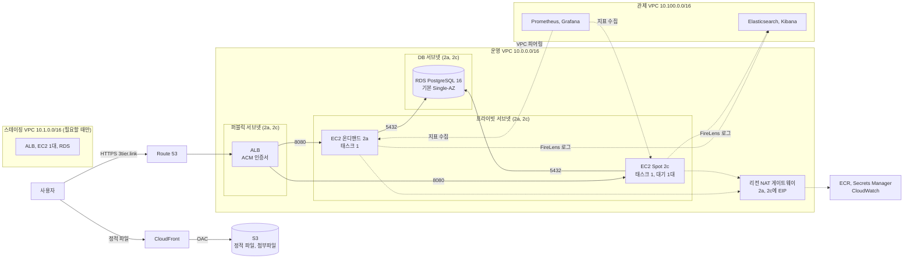
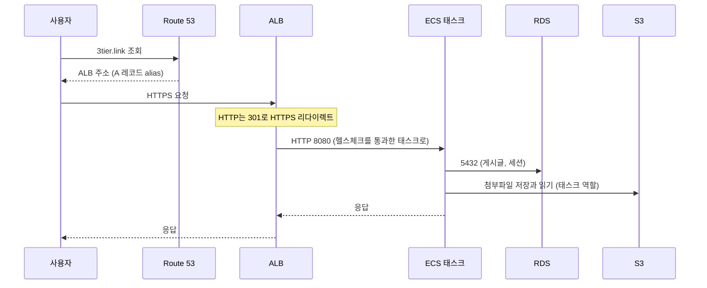
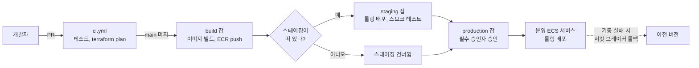

# 아키텍처 설계

Spring Boot 웹 서비스를 AWS 3계층으로 올린 구성과 그렇게 고른 이유다. 설계 기준은 AWS Well-Architected의 보안, 복원력, 성능, 비용 최적화였고 요구사항은 네 가지였다. 가용 영역 하나가 죽어도 서비스와 재배포가 이어질 것, HTTPS, 정적 파일 분리, 영구 액세스 키 0개. 주요 결정은 [결정 기록](adr/)에 따로 있다.

## 1. 전체 구조



| 계층 | 서브넷 | 들어 있는 것 | 외부 접근 |
|---|---|---|---|
| 진입 | 퍼블릭 | ALB | 인터넷에서 ALB 443, 80만 |
| 앱 | 프라이빗 | ECS 태스크 (EC2 위, awsvpc) | 불가. ALB를 거쳐서만 |
| 데이터 | DB | RDS | 불가. 앱 태스크에서만 |

세 계층을 나누는 건 서브넷과 Security Group이다. 앱이 서버에서 HTML을 그리는 Thymeleaf여도 계층은 어느 서브넷에 있고 누가 누구에게 접근하느냐로 나뉜다. 웹 서버 자리는 ALB가 맡고, 정적 파일은 CloudFront와 S3로 뺐다.

## 2. 요청 흐름



- 세션은 RDS의 `SPRING_SESSION` 테이블에 둔다. 어느 태스크가 요청을 받아도 로그인이 유지된다.
- ALB 헬스체크는 `/actuator/health/liveness`다. DB가 끊겨도 200을 돌려줘서 DB 장애 때 태스크가 쓸데없이 교체되지 않는다. DB 연결 장애는 5xx 비율 알람으로 잡는다([관측과 알림](monitoring.md)).

## 3. 배포 흐름



- GitHub Actions는 OIDC로 역할을 받는다. 운영 역할은 이 레포의 main, PR, `production` 환경만, 스테이징 역할은 `staging` 환경만 받을 수 있다.
- 한 번 빌드한 이미지를 스테이징에 먼저 배포하고 스모크 테스트(health, `/posts` 200)를 한다. 스테이징이 내려가 있으면 건너뛴다.
- 운영 배포는 GitHub Environment `production`의 필수 승인자가 승인해야 시작한다. 비공개 레포에서는 쓸 수 없는 기능이라 레포를 공개로 바꾼 뒤 켰다.
- main은 PR로만 바꾼다. 브랜치 보호 규칙은 `.github/rulesets/main.json`에 정의해 뒀다.
- 롤링 배포는 최소 50%, 최대 200%다. 처음에는 최소 100%였는데 Spot 회수 때 옛 태스크를 바로 빼야 요청을 다른 태스크로 넘길 수 있어서 50%로 낮췄다([DEC-67](adr/0067-spot-capacity-mix.md)). 대신 배포나 회수 때 1~2분 동안 태스크가 1개다.
- 새 태스크가 계속 기동에 실패하면 ECS 서킷 브레이커가 이전 태스크 정의로 되돌린다.

## 4. 네트워크

### 4.1 CIDR와 서브넷

| 서브넷 | CIDR | 가용 영역 | 용도 |
|---|---|---|---|
| public-a, public-c | 10.0.0.0/24, 10.0.1.0/24 | 2a, 2c | ALB |
| private-a, private-c | 10.0.10.0/24, 10.0.11.0/24 | 2a, 2c | ECS 태스크 |
| db-a, db-c | 10.0.20.0/24, 10.0.21.0/24 | 2a, 2c | RDS |

- 세 번째 자리 0번대는 퍼블릭, 10번대는 프라이빗, 20번대는 DB라 번호만 보고 계층을 안다. /24 하나에 IP가 251개라 태스크 수십 개까지 여유가 있다.
- 가용 영역은 서울에서 가장 먼저 생긴 2a와 2c를 골랐다. 둘 사이 지연은 1ms 안팎이다.
- RDS 서브넷 그룹은 가용 영역 2곳 이상을 요구해서 Single-AZ여도 DB 서브넷이 2개다. Multi-AZ를 켜면 주 DB가 없는 쪽에 대기 인스턴스가 생긴다. 어느 쪽이 주 DB가 될지는 AWS가 정한다.

### 4.2 라우팅과 NAT

| 라우트 테이블 | 연결 서브넷 | 0.0.0.0/0 | 그 밖의 경로 |
|---|---|---|---|
| public | public-a, public-c | 인터넷 게이트웨이 | |
| private-a, private-c | private-a, private-c | 리전 NAT (같은 ID) | 관제 VPC 피어링, S3 게이트웨이 엔드포인트 |
| db | db-a, db-c | 없음 | 없음 (외부로 나가는 경로 자체가 없음) |

- 운영 NAT는 리전 NAT 게이트웨이 하나를 수동 모드로 썼다. NAT ID 하나가 2a와 2c에 EIP를 하나씩 두고 동작해서, 한 영역이 죽어도 다른 영역 태스크가 ECR과 Secrets Manager에 닿는다. 영역 NAT 2개와 요금이 같고 두 라우트 테이블이 같은 NAT ID를 가리켜 경로가 단순하다. 자동 모드는 새 영역으로 펼쳐지는 데 최대 60분이 걸려 수동 모드를 골랐다.
- NAT로 나가는 건 ECR API, Secrets Manager, CloudWatch Logs 같은 AWS API 호출이다. S3(첨부파일, ECR 이미지 레이어)는 S3 게이트웨이 엔드포인트로 간다. 추가 요금이 없고 NAT를 거치지 않는다.

### 4.3 Security Group

표에 있는 것만 허용하고 나머지는 모두 막는다.

| SG | 인바운드 | 아웃바운드 |
|---|---|---|
| alb | 443, 80 ← 0.0.0.0/0 | 8080 → app |
| app | 8080 ← alb, 8080 ← 관제 Prometheus | 5432 → db, 443 → 0.0.0.0/0, 9200 → 관제 ELK |
| db | 5432 ← app | 없음 |

- 출발지는 CIDR 대신 SG 참조로 적었다. 태스크 IP는 배포마다 바뀌지만 SG는 그대로다. 피어링한 VPC끼리도 SG를 참조할 수 있어서 관제 쪽 규칙도 SG로 좁혔다.
- app의 아웃바운드 443은 AWS API 호출용, 9200은 FireLens 사이드카가 관제 VPC로 로그를 보내는 길이다.
- 관제 Prometheus SG는 인바운드가 없고(접속은 SSM), 아웃바운드는 수집 포트(9100, 8081, 8080)와 443만 연다.
- 앱 지표 경로 `/actuator/prometheus`는 세 겹으로 막았다. ALB HTTPS 리스너 규칙이 404를 돌려주고, 앱은 ALB를 거친 요청(`X-Forwarded-For`가 붙은 요청)을 거부하고, app SG는 8080을 ALB와 관제 Prometheus에만 연다. 앱 쪽 차단이 있어서 앱 배포가 ALB 규칙보다 먼저 끝나도 공개되지 않는다.
- db의 아웃바운드는 비웠다. DB가 먼저 연결을 시작할 일이 없다. 80은 HTTPS로 301 리다이렉트하려고만 연다.

### 4.4 관제 VPC와 피어링

| 서브넷 | CIDR | 가용 영역 | 용도 |
|---|---|---|---|
| mon-public-a | 10.100.0.0/24 | 2a | 영역 NAT 자리만. ALB나 공인 IP 인스턴스는 없음 |
| mon-private-a, mon-private-c | 10.100.10.0/24, 10.100.11.0/24 | 2a, 2c | Prometheus와 Grafana, Elasticsearch와 Kibana |

- 관제 서버를 운영 VPC와 다른 VPC에 둬서 장애 영역을 나눴다([DEC-40](adr/0040-three-vpcs-peering.md)). 운영과 같은 network 모듈로 만든다.
- 관제 NAT는 영역 NAT 1개다. 세션 동안만 쓰는 관제라 2a 장애 때 2c 서버가 밖으로 못 나가는 건 감수했다.
- 피어링은 관제와 운영 사이 하나다. 스테이징은 관제와 잇지 않고 배포 워크플로의 스모크 테스트로 확인한다.
- S3 게이트웨이 엔드포인트는 피어링으로 빌려 쓸 수 없어서 세 VPC에 각각 뒀다.
- Prometheus는 앱 태스크를 Cloud Map 비공개 DNS `board.3tier-prod.internal`로 찾는다. 피어링은 DNS를 넘기지 않아서 이 존에 관제 VPC를 따로 연결했다.

## 5. 컴퓨트와 데이터

### 5.1 ECS

| 항목 | 값 |
|---|---|
| 클러스터 | `3tier-prod-cluster`, Container Insights 켬 |
| 인스턴스 | t3.small, ECS 최적화 Amazon Linux 2023, gp3 30 GB 암호화 |
| 접속 | SSM만. SSH 키 없음, IMDSv2만 허용 |
| 태스크 | 0.5 vCPU, 1 GB. 원하는 수 2 (가용 영역마다 1개) |
| 오토스케일링 | 2~4개, CPU 60% 목표 추적, 늘림 쿨다운 60초, 줄임 300초 |
| 배포 | 롤링 최소 50%, 최대 200%, 서킷 브레이커 롤백 |
| 헬스체크 | `/actuator/health/liveness`, 15초 간격, 정상 2회와 비정상 2회 |
| 종료 대기 | `stopTimeout` 30초 (앱 정상 종료 대기 20초보다 길게) |

용량 공급자는 2개다. 온디맨드 ASG(2a 서브넷, 최소 1대)와 Spot ASG(2c 서브넷, t3.small과 t3a.small, `price-capacity-optimized`, 용량 재조정 켬)다. 서비스 전략은 온디맨드 `base=1, weight=0`, Spot `weight=1`이라 온디맨드 1대가 태스크 1개를 늘 받친다. Spot 용량 공급자의 목표 사용률을 50%로 둬서 Spot 태스크 1개마다 빈 인스턴스 1대가 대기하고, 회수 예고(2분)가 오면 바로 옮긴다([DEC-67](adr/0067-spot-capacity-mix.md)). `enable_spot=false`로 띄우면 온디맨드 ASG가 두 영역을 쓰고 최소 2대가 된다.

- 처음에는 Fargate였다. 호스트에 에이전트(node_exporter, cAdvisor)를 올리고 태스크와 인스턴스 두 단계 스케일링을 재 보려고 EC2로 바꿨다([DEC-36](adr/0036-fargate-to-ecs-on-ec2.md)). Fargate 구성은 git 태그 `v1-fargate`에 있다.
- t3.small에는 1 GB 태스크가 하나만 들어간다. ASG 상한을 태스크 상한(4개)의 두 배인 8대로 둬서 태스크 4개 상태에서 배포해도 자리가 모자라지 않게 했다. 관리형 종료 보호와 드레이닝을 켜서 태스크가 도는 인스턴스는 먼저 꺼지지 않는다.
- 서비스의 원하는 태스크 수는 Terraform이 무시하게 했다. 그러지 않으면 오토스케일링이 늘린 값을 다음 apply가 2로 되돌린다.

DB 계정과 관리자 비밀번호(`DB_USERNAME`, `DB_PASSWORD`, `ADMIN_PASSWORD`)는 실행 역할이 Secrets Manager에서 읽어 넣는다. 태스크 정의에는 평문이 없다. 나머지(`DB_URL`, `STORAGE_TYPE`, `S3_BUCKET`, `AWS_REGION`)는 환경 변수다.

### 5.2 RDS

| 항목 | 값 |
|---|---|
| 엔진 | PostgreSQL 16.15. 마이너 버전은 자동 반영 |
| 클래스 | db.t4g.micro (Graviton), gp3 20 GB |
| Multi-AZ | 변수 `multi_az`, 기본 끔 (장애 실험 때만 켬) |
| 접근 | 퍼블릭 접근 불가. DB 서브넷과 db SG |
| 백업, 삭제 보호 | 백업 1일, 삭제 보호 끔. 자주 지우고 다시 만드는 걸 전제로 함 |
| 비밀번호 | Terraform `random_password`로 만들어 Secrets Manager에 저장 |

Multi-AZ를 켜고 강제 장애 조치를 한 기록은 [RDS 장애 조치](troubleshooting/06-rds-failover.md)에 있다. 비밀번호는 코드에 평문이 없지만 Terraform state에는 남는다. 그래서 state 버킷 접근을 막는 게 곧 비밀번호를 지키는 일이다.

### 5.3 S3와 CloudFront

버킷 하나를 두 용도로 쓴다. 퍼블릭 액세스는 네 항목 모두 막았고 SSE-S3로 암호화했다.
- 첨부파일: 앱이 태스크 역할로 읽고 쓴다. 다운로드는 앱이 권한을 확인한 뒤 S3에서 읽어 내려주므로 CloudFront를 거치지 않는다.
- 정적 파일(`/static/*`): CloudFront가 OAC로 읽어 서빙한다. 버킷에 직접 접근하는 길은 막혀 있다.

## 6. 보안과 IAM

### 6.1 인증

| 주체 | 인증 방식 | 영구 키 |
|---|---|---|
| 개발자 (콘솔, 로컬 Terraform) | IAM Identity Center `3tier-admin`과 MFA, CLI 프로필 `3tier` | 없음 |
| GitHub Actions | OIDC 토큰으로 운영, 스테이징 배포 역할을 받음 | 없음 |
| ECS 태스크 | 태스크 역할 `3tier-prod-ecs-task` | 없음 |
| EC2 컨테이너 인스턴스 | 인스턴스 프로필 `3tier-prod-ecs-instance` | 없음 |

이 프로젝트에서 영구 액세스 키를 쓰는 주체는 없다([DEC-14](adr/0014-identity-center-mfa.md)).

### 6.2 역할과 최소 권한

| 역할 | 받는 주체 | 권한 |
|---|---|---|
| `3tier-github-deploy` | GitHub Actions | 서비스별 고객 관리형 정책 7개 |
| `3tier-prod-ecs-task-execution` | ECS (태스크 실행) | 이미지 풀, 로그 쓰기, DB 비밀 읽기 |
| `3tier-prod-ecs-task` | 앱 컨테이너 | S3 버킷 1개 읽기와 쓰기 |
| `3tier-prod-ecs-instance` | ECS 에이전트 | 클러스터 등록, 태스크 상태 보고, SSM 접속 |

배포 역할은 AdministratorAccess로 시작했다. CloudTrail 호출 기록을 보고 실제로 쓴 권한만 남겨 정책 7개로 좁혔다([DEC-24](adr/0024-deploy-role-least-privilege.md), `terraform/bootstrap/deploy_policies.tf`).
- 리소스는 이름과 ARN으로 좁혔다. 이름이 없는 EC2 리소스의 삭제는 `Project` 태그가 붙은 것만 허용했다.
- 배포 역할이 만드는 역할에는 permissions boundary `3tier-ecs-boundary`가 붙어야만 한다. 그래서 어떤 정책을 넣어도 ECS 역할의 실제 권한은 boundary 안에 머문다.
- 배포 역할 자신, 그 정책, boundary는 명시적 Deny로 수정과 삭제를 막았다.

실행 역할과 태스크 역할을 나눈 이유: 실행 역할은 컨테이너를 띄우는 ECS의 권한이고 태스크 역할은 컨테이너 안 코드의 권한이다. 앱은 비밀을 직접 읽을 필요가 없어서 태스크 역할에는 Secrets Manager 권한을 주지 않았다.

## 7. Terraform 구조

```
terraform/
├── bootstrap/   처음 한 번 만들고 유지 (state 버킷, OIDC와 배포 역할, ECR, 알람 토픽, 예산, FIS)
├── main/        운영과 관제 VPC. 세션마다 만들고 지움
├── staging/     스테이징 VPC. 필요할 때만
└── modules/     network, vpc_peering, data, compute, observability, monitoring, logging
```

- bootstrap을 따로 둔 이유: main을 매일 지워도 state 버킷, 배포 역할, 이미지 저장소, 호스팅 존은 남아야 한다.
- main은 평소 GitHub Actions로만 apply했다. 장애 실험용 변수(RDS Multi-AZ 같은 것)만 로컬에서 줬다.
- state는 S3 네이티브 잠금(`use_lockfile = true`)을 쓴다. 세 루트가 같은 버킷의 다른 키를 쓴다.
- network 모듈 하나로 운영, 관제, 스테이징 VPC를 모두 만든다. 모든 리소스에는 `default_tags`로 `Project`, `Env`, `Owner` 태그를 붙여 비용을 나눌 때 썼다.

## 8. 설계 판단

| 판단 | 선택 | 이유 |
|---|---|---|
| 컴퓨트 | ECS on EC2 (온디맨드 1대와 Spot) | 호스트 관측과 두 단계 스케일링. EKS는 제어 플레인만 월 73 USD |
| DB 배치 | DB 서브넷, 외부 경로 없음 | 접근은 app SG에서만 |
| DB 가용성 | Single-AZ, Multi-AZ는 변수 | 시간당 0.03 USD로 DB 중단을 약 44초로 줄이지만 세션 운영이라 끔 |
| NAT | 리전 NAT 1개, 두 영역에 EIP | 다중 AZ 요구사항, 영역 NAT 2개와 같은 요금 |
| 배포 인증 | GitHub OIDC | 액세스 키 없음, 레포와 브랜치로 제한 |
| 사람 인증 | IAM Identity Center와 MFA | 영구 키 0개 |
| 세션 | Spring Session JDBC (RDS) | 태스크 사이 로그인 공유. Redis는 범위 밖 |
| 스키마 | Flyway | 태스크가 동시에 떠도 잠금으로 한 번만 적용 |
| 헬스체크 | liveness (DB 제외) | DB 장애 때 태스크 교체가 반복되지 않게 |
| 정적 파일 | S3와 CloudFront | 정적 파일 분리 요구사항 |
| state 잠금 | S3 네이티브 | 1.11부터 정식. DynamoDB 방식은 폐기 예정 |

## 9. 위험과 한계

| 항목 | 영향 | 대응 |
|---|---|---|
| RDS Single-AZ | DB가 있는 영역이 죽으면 서비스 전체가 멈춘다 | 비용 때문에 감수. Multi-AZ였다면 약 44초 뒤 회복 |
| CloudWatch ECS 지표 지연 (약 4분) | CloudWatch 알람이 장애를 늦게 잡는다 | Prometheus 15초 수집과 Grafana 규칙으로 보완 |
| SSE 알림을 태스크 메모리에 둠 | 태스크가 2개 이상이면 알림이 빠질 수 있고, ALB 유휴 60초마다 연결이 끊겨 5xx가 가끔 난다 | 5xx 비율 알람은 분당 10건 미만을 0으로 계산. 앱 구조 개선은 범위 밖 |
| 운영과 스테이징이 같은 AWS 계정 | VPC는 네트워크만 나누고 IAM 권한과 서비스 한도는 못 나눈다 | 환경별 역할, 비밀, 버킷을 분리. 실무라면 계정을 나눈다 |
| 시드 계정 비밀번호 1111 | 공개 레포에 있어 그대로 두면 누구나 관리자로 로그인한다 | 운영과 스테이징은 기동 때 Secrets Manager 값으로 admin 비밀번호를 바꾼다 |
| ECR 최신 이미지를 그대로 선택 | main 밖에서 push한 이미지가 다음 apply에 쓰일 수 있다 | 이미지 push는 main의 배포 워크플로만 한다 |
