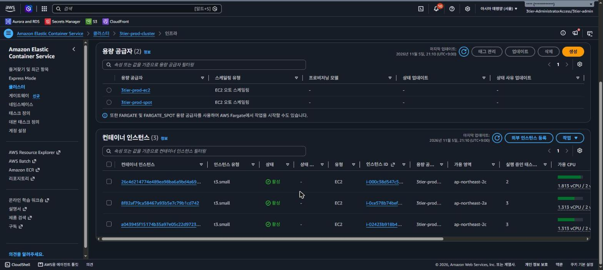

# 비용

이 구성을 띄우는 데 얼마가 들고, 무엇을 줄였고, 무엇은 비용을 감수하고 골랐는지에 대한 기록이다. 서울 리전 온디맨드 요금, USD 기준이다.

## 1. 한눈에 보기

| 구성 | 시간당 | 8시간 세션 |
|---|---|---|
| 전부 켬 (운영, 관제, 중앙 로그) | 약 0.393 USD | 약 3.14 USD |
| 관측 서버 끔 (운영만) | 약 0.258 USD | 약 2.06 USD |

평소에는 운영 환경을 destroy해 두고 필요할 때만 띄웠다. 내려 둔 동안에는 월 약 1.7 USD만 나간다.

## 2. 항목별 비용

| 항목 | 시간당 (USD) | 비중 |
|---|---|---|
| 운영 리전 NAT (2a, 2c에 EIP 1개씩) | 0.128 | 약 33% |
| ALB (퍼블릭 IPv4 2개 포함) | 0.04 | 약 10% |
| 컴퓨트 (t3.small 온디맨드 1대, Spot 2대, gp3 30 GB 3개) | 0.050 | 약 13% |
| RDS (db.t4g.micro, gp3 20 GB) | 0.03 | 약 8% |
| 기타 (Secrets Manager, 로그, 알람, Route 53, CloudFront, S3) | 약 0.01 | 약 3% |
| 관제 VPC와 서버 (영역 NAT 1개, t4g.small) | 0.088 | 약 22% |
| 중앙 로그 서버 (t4g.medium) | 0.047 | 약 12% |
| 합계 | 약 0.393 | |

NAT가 운영과 관제를 합쳐 가장 컸다. 관제 비용의 73%도 NAT다. RDS는 가장 작은 Graviton 급을 Single-AZ로 썼다. 컴퓨트는 EKS 대신 ECS를 골랐다. EKS는 제어 플레인만 월 73 USD다.

## 3. 줄인 것

### 3.1 쓸 때만 켜기 (88% 절감)

비용을 가장 크게 줄인 건 켜 두는 시간이었다. Fargate로 시작했을 때 구성(시간당 0.265 USD)으로 계산하면 24시간 켜 두는 경우 월 195.04 USD다. 8시간 세션을 월 10번(80시간)만 켜면 월 22.79 USD로 88% 줄어든다. 이 값에는 상시 유지분과 NAT 데이터 처리 가정치가 들어 있다.

대가는 기다리는 시간이다. 세션을 시작할 때마다 apply부터 접속 가능까지 9분 44초가 걸린다([측정 기록](measurements.md)).

### 3.2 Spot (컴퓨트 15% 절감)

태스크 2개 중 1개를 Spot 인스턴스에 두었다. 용량 공급자 전략은 온디맨드 `base=1, weight=0`, Spot `weight=1`이다. 온디맨드 1대가 태스크 1개를 늘 받치므로 Spot이 전부 회수돼도 서비스는 이어진다. Spot 단가는 온디맨드의 약 25%(0.0064 USD/시간)였다.

| 구성 | 컴퓨트 시간당 (USD) |
|---|---|
| 온디맨드 2대 | 0.059 |
| 온디맨드 1대, Spot 1대 | 0.040 |
| 온디맨드 1대, Spot 2대 (대기 1대) | 0.050 (채택) |

대기 인스턴스가 Spot으로 아낀 돈의 절반 가까이를 다시 쓴다. 그래도 이쪽을 골랐다. 대기 인스턴스와 최소 정상 비율 50%를 같이 두자 Spot 회수 때 사용자 실패가 0건이 됐다([Spot 회수](troubleshooting/07-spot-interruption.md)). 실패 13~18건을 감수하고 시간당 0.010 USD를 더 아끼는 건 맞지 않다고 봤다.

운영 전체로는 시간당 0.267 USD에서 0.258 USD가 됐다. 컴퓨트가 운영 비용의 약 20%라 효과는 작았다. 운영 비용의 대부분은 NAT, ALB, RDS 같은 고정분이다.

용량 공급자 2개(`3tier-prod-ec2`, `3tier-prod-spot`)와 컨테이너 인스턴스 3대(2a 온디맨드 1대, 2c Spot 2대)다.

### 3.3 관측 서버 끄기 (34% 절감)

`terraform/main` 변수 `enable_monitoring`, `enable_logging`을 `false`로 주면 관제 VPC, Prometheus와 Grafana, Elasticsearch와 Kibana, 호스트 에이전트, FireLens 사이드카를 만들지 않는다. 기본값은 켬이다.

| 세션 | 시간당 (USD) | 8시간 세션 (USD) |
|---|---|---|
| 전부 켬 | 0.393 | 3.144 |
| 관측 둘 다 끔 | 0.258 | 2.064 |

측정이나 장애 추적이 없는 세션(문서 작업, 배포 흐름 확인)에서만 껐다.

## 4. 비용보다 다른 것을 고른 곳

### 4.1 NAT를 두 가용 영역에

NAT를 하나로 줄이면 돈은 반으로 준다.

| 구분 | NAT 2개 | NAT 1개 |
|---|---|---|
| 시간당 | 0.128 USD | 0.064 USD |
| 8시간 세션 | 1.024 USD | 0.512 USD |
| 월 730시간 | 93.44 USD | 46.72 USD |

대신 NAT가 있는 가용 영역이 죽으면 다른 영역의 태스크도 밖으로 나갈 길을 잃는다.

| 죽은 가용 영역 | NAT 2개 | NAT 1개 (2a에만) |
|---|---|---|
| 2a | 2c 태스크가 계속 나가고 재배포도 된다 | 2c 태스크가 ECR과 Secrets Manager에 닿지 못해 재배포가 막힌다 |
| 2c | 2a 태스크가 계속 나가고 재배포도 된다 | 2a 태스크가 계속 나가고 재배포도 된다 |

세션당 0.5 USD를 아끼려고 한쪽 영역 장애가 배포 전체 장애가 되는 구성을 받아들이지 않았다. 지금은 리전 NAT 하나가 두 영역에 EIP를 하나씩 두고 동작하는데 요금은 NAT 2개와 같다. 데이터 처리 요금은 NAT 개수와 상관없다. 단, RDS가 Single-AZ라서 DB가 있는 영역이 죽으면 NAT와 상관없이 서비스가 멈춘다.

### 4.2 태스크 0.5 vCPU

0.25 vCPU에서는 앱 기동이 120초를 넘고 첫 응답에 몇 초가 걸렸다. 0.5 vCPU, 1 GB로 올리자 기동이 121~123초에서 23초로 줄었다. Fargate 비용은 시간당 0.029 USD 늘어 두 배가 됐다([DEC-46](adr/0046-task-size-upgrade.md)).

### 4.3 Fargate에서 ECS on EC2로

비용 때문에 바꾼 게 아니다. 호스트 지표를 모으고 태스크와 인스턴스 두 단계 스케일링을 재 보려고 바꿨다([DEC-36](adr/0036-fargate-to-ecs-on-ec2.md)). 그래도 비용이 비슷한지는 확인했다. 컴퓨트는 시간당 0.057 USD에서 0.059 USD로 약 4% 늘었다. 배포 한 번과 부하 시험 한 번이 있는 8시간 세션으로 치면 2.157 USD에서 2.197 USD로 약 0.04 USD(2%) 차이였다. 배포나 부하가 더 잦으면 인스턴스가 늦게 줄어드는 만큼 차이가 벌어진다. 얻은 것과 감수한 것(느려진 응답, destroy 순서 같은 운영 책임)은 [측정 기록](measurements.md)에 있다.

### 4.4 관측 서버 직접 설치

이 프로젝트 규모에서는 CloudWatch가 Prometheus와 Grafana를 직접 설치하는 것보다 쌌다. 그래도 15초 단위 수집과 더 빠른 탐지를 위해 직접 설치했다([관측 비교](monitoring.md)). 관제 서버가 밖으로 나가는 길은 NAT로 뒀다. 인터페이스 엔드포인트 4~5개를 영역마다 두는 쪽이 NAT 1개보다 비쌌기 때문이다.

## 5. 실제 청구액

Cost Explorer로 2026-10-01 ~ 11-04 청구액을 봤다.

| 구분 | 금액 (USD) |
|---|---|
| 계정 전체 | 56.70 |
| 이 프로젝트와 무관한 리소스 | -18.55 |
| 세금 | -5.15 |
| 도메인 1년 | -5.00 |
| 이 프로젝트 세션 운영비 | 약 28.0 |

| 큰 항목 | 금액 (USD) | 사용량 |
|---|---|---|
| NAT Gateway 시간 | 10.32 | 175시간 |
| 퍼블릭 IPv4 사용 중 | 3.22 | 643시간 |
| 퍼블릭 IPv4 유휴 | 2.13 | 426시간 |
| RDS db.t4g.micro | 2.33 | 93.3시간 |
| ALB | 2.09 | 93시간 |

- ALB 청구 시간 93시간이 운영 스택이 떠 있던 시간이다. 세션 운영비를 이 시간으로 나누면 시간당 약 0.30 USD로, 요금표로 추정한 범위 안에 들어왔다.
- 가장 큰 건 NAT(37%)와 프로젝트 몫 퍼블릭 IPv4(약 4.25 USD, 15%)였다. 둘 다 컴퓨트나 DB보다 컸다.
- 유휴 퍼블릭 IPv4 2.13 USD는 연결되지 않은 EIP가 며칠 남아 있던 비용이다. 아무 일도 안 한 돈이라, 이런 누락을 일찍 알아차리려고 월 50 USD 예산과 실제 80%, 100%, 예측 100% 알림을 걸었다.
- 비용 할당 태그로만 보면 NAT 일부, 퍼블릭 IPv4, Fargate처럼 태그가 붙지 않는 항목이 빠져 절반 이하로 잡혔다. 그래서 사용 유형별로 나눠 봤다.

## 6. 스테이징과 평소 유지비

스테이징은 운영과 같은 모듈을 작은 사양으로 띄운 별도 환경이다. 시간당 0.174 USD로 운영의 약 65%다. 인스턴스를 1대로 줄여도 NAT, ALB, RDS처럼 하나는 있어야 하는 고정분이 남는다. 비용의 60%가 NAT와 ALB인데 둘 다 시간 단위로 청구된다. 그래서 세션 중 필요한 구간에만 띄우고 확인이 끝나면 바로 지웠다. NAT를 빼면 더 싸지만 운영과 네트워크 경로가 달라져 미리 검증하는 의미가 줄어서 그대로 뒀다.

운영을 destroy해 둔 동안 남는 비용은 이렇다.

| 항목 | 월 (USD) |
|---|---|
| Route 53 호스팅 존 | 0.50 |
| KMS 고객 관리형 키 (알람 토픽 암호화) | 1.00 |
| ECR 이미지 1.66 GB | 약 0.17 |
| state 버킷, 예산, FIS 템플릿, IAM | 약 0 |
| 합계 | 약 1.7 |

ECR은 수명 주기 규칙이 있어 이 크기에서 더 늘지 않는다.

## 7. 한계와 개선 방향

한계:
- 1~4절은 요금표로 계산한 추정이다. 실제 청구액은 5절이다.
- NAT 데이터 처리량은 가정치다(24시간 가동 월 10 GB, 세션 1회 1 GB). 실측하지 않았다.
- t3 CPU 크레딧 초과 요금은 계산에 넣지 않았다. 실제 청구에도 따로 나오지 않았다.
- 요금은 2026-10 ~ 11에 AWS 요금 페이지와 Price List API로 확인한 서울 리전 값이다.

개선 방향:
- 24시간 운영으로 바뀌면 꾸준히 쓰는 컴퓨트에 Compute Savings Plans를 거는 게 맞다. 1년이나 3년 약정으로 최대 72%까지 줄고 EC2와 Fargate 모두에 적용된다([Savings Plans](https://docs.aws.amazon.com/savingsplans/latest/userguide/what-is-savings-plans.html)).
- 트래픽이 늘어 NAT 데이터 처리 요금이 커지면 AWS 서비스로 가는 트래픽을 VPC 엔드포인트로 돌리면 된다. AWS도 트래픽 대부분이 AWS 서비스로 간다면 엔드포인트를 쓰라고 권한다([NAT 게이트웨이 요금](https://docs.aws.amazon.com/vpc/latest/userguide/nat-gateway-pricing.html)).
- NAT 데이터 처리량을 NAT 게이트웨이 지표로 실제로 재 두면 가정치를 실측으로 바꿀 수 있다.
