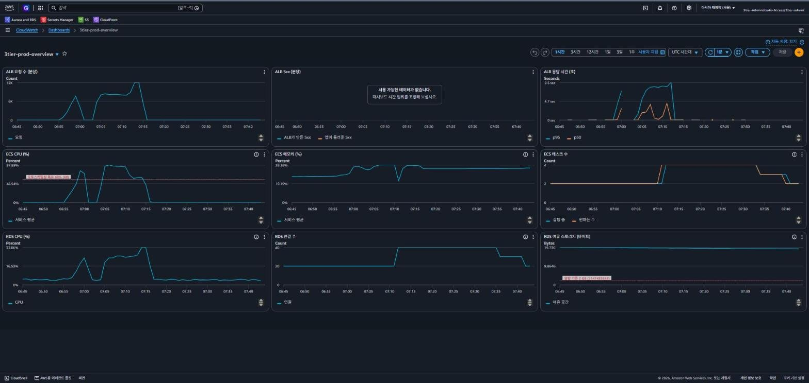

# 측정 기록

품질 목표를 세우고 재생성, 배포, 롤백, 부하, 컴퓨트 전환을 실제로 잰 결과다. 장애 실험 기록은 [troubleshooting](troubleshooting/)에 따로 있다.

## 1. 품질 목표와 결과

목표는 DORA 지표, Google SRE 권장치, 첫 측정값을 참고해 정했다.

| 항목 | 목표 | 결과 | 판정 |
|---|---|---|---|
| 머지부터 운영 안정화까지 | 10분 이내 | 최대 7분 38초 | 통과 |
| 실패한 배포 자동 롤백 | 10분 이내 | 5분 19초 | 통과 |
| 확장 뒤 응답 시간 | p95 200 ms 미만, p99 500 ms 미만 | p95 52 ms, p99 237 ms | 통과 |
| 장애 시작부터 Slack 알림까지 | 5분 이내 | Grafana 4분 10초, CloudWatch 6분 26초 | Grafana만 통과 |
| 부하 시작부터 새 태스크 정상까지 | 10분 이내 | 8분 48초 | 통과 |
| 태스크 1개 종료 때 사용자 오류 | 0건 | 0건 | 통과 |
| 전체 apply / destroy | 15분 / 10분 이내 | 8분 51초 / 6분 51초 | 통과 |
| 8시간 세션 비용 | 3 USD 이하 | 관측 서버 끈 세션 약 2.06 USD, 켠 세션 약 3.14 USD | 끈 세션만 통과 |

탐지 시간은 [monitoring.md](monitoring.md), 비용은 [cost.md](cost.md)에 자세히 있다.

## 2. 재생성 시간

마지막 구성(운영 VPC, 관제 VPC, 용량 공급자 2개, 관측 서버 포함)을 GitHub Actions로 지운 뒤 다시 만들었다(2026-11-05).

| 구간 | 결과 |
|---|---|
| apply (리소스 148개) | 8분 51초 |
| 워크플로 시작부터 `/posts` 첫 200까지 | 9분 44초 |
| destroy | 6분 51초 |

리소스가 82개에서 148개로 늘었는데 apply는 17초만 늘었다.

## 3. 배포와 롤백

### 3.1 배포

`app/**` 변경을 main에 머지하면 GitHub Actions가 이미지를 빌드해 ECR에 올리고 ECS를 롤링 배포한다. 같은 날 같은 단계를 수동으로도 해서 비교했다(2026-10-28, 태스크 2개). 당시 롤링 배포의 최소 정상 비율은 100%였다. 지금은 50%다.

| 구분 | 수동 | 자동 (캐시 적중) | 자동 (코드 변경) |
|---|---|---|---|
| 시작부터 서비스 안정화까지 | 5분 18초 | 5분 5초 | 7분 38초 |
| 사람이 하는 일 | 명령 13개 | PR 머지 1번 | PR 머지 1번 |

걸린 시간은 수동과 비슷했다. ECS 롤링 자체는 세 경우 모두 3분 남짓으로 같았다. 코드를 바꾼 경우에는 빌드와 push에 3분 58초가 걸렸는데, 그중 2분 36초가 다음 빌드를 위해 캐시를 내보내는 시간이었다. 수동 값은 명령을 스크립트로 이어 실행한 최솟값이라 사람이 입력하고 확인하는 시간은 빠져 있다. 자동화로 줄어든 건 시간보다 손이 가는 일이었다. 명령 13개를 치던 배포가 PR 머지 한 번으로 끝났다.

워크플로는 서비스가 안정된 뒤에도 2분 넘게 늦게 끝났다. 배포 액션이 서비스 상태를 확인하는 간격이 점점 길어졌기 때문이다. 이 간격의 상한을 15초로 고쳤다.

### 3.2 롤백

기동에 실패하는 이미지를 일부러 배포했다. 서킷 브레이커가 4분 5초 만에 실패로 판정했고, 1분 14초 뒤 이전 버전으로 돌아왔다. 합계 5분 19초 동안 응답 217회가 모두 200이었다. 자세한 기록은 [잘못된 이미지 배포](troubleshooting/02-bad-image-rollback.md)에 있다.

## 4. 오토스케일링 부하 시험

ECS 서비스가 CPU 60% 목표로 태스크 2개에서 4개 사이를 오가는지 k6로 확인했다(2026-10-29, Fargate). 스크립트와 실행법은 [load/README.md](../load/README.md)에 있다.

- 요청: 비로그인 GET, 목록 3 : 상세 7
- 방식: 초당 요청 수를 고정(`ramping-arrival-rate`)
- 본 시험: 200 RPS로 12분
- 부하는 집 PC에서 줬다. 시험 중 PC CPU는 80% 미만이었다

### 4.1 포화점

본 시험 전에 30, 60, 120, 200 RPS를 1분씩 줬다.

| RPS | ECS 평균 CPU | ALB p95 |
|---|---|---|
| 30 | 15% | 34 ms |
| 60 | 30% | 26 ms |
| 120 | 48% | 26 ms |
| 200 | 83% | 3.97초 |

태스크 2개는 약 125 RPS에서 포화했다. 태스크 하나가 약 60 RPS를 받는 셈이다. 그래서 본 시험은 포화점을 넘는 200 RPS로 정했다.

### 4.2 늘고 주는 시간

CloudWatch 대시보드에서 본 태스크 수 변화다. 2개에서 4개로 한 번에 늘었다가 부하가 끝나고 2개로 돌아왔다.

| 구간 | 소요 |
|---|---|
| 부하 시작부터 늘림 결정까지 | 약 7분 |
| 늘림 결정부터 4개 모두 정상까지 | 75초 |
| 부하 종료부터 줄임 결정까지 | 17분 |
| 부하 종료부터 2개 복귀까지 | 24분 |

늘림 결정은 예상한 3~4분보다 오래 걸렸다. CPU가 목표의 1.5배를 넘어 목표 추적이 3.2개를 계산했고, 올림해서 4개가 됐다. 줄일 때는 1개씩 두 번 줄었고 그 사이에 쿨다운 300초가 들어갔다.

### 4.3 응답 시간

| 구간 | 클라이언트 p95 | 클라이언트 p99 | ALB p95 |
|---|---|---|---|
| 늘어나기 전 (태스크 2개) | 9,427 ms | 12,139 ms | 7.66초 |
| 늘어난 뒤 안정 (태스크 4개) | 52 ms | 237 ms | 31 ms |

태스크가 4개가 된 직후 약 80초는 포화 때 밀린 요청이 끝나느라 p95가 11초대였다. 그 뒤로는 52 ms로 내려왔다.

본 시험 전체 요청은 101,105건이었고 실패 1건, 5xx 0건이었다. 포화 중에는 응답이 느려져 보내지 못한 요청이 생겨서 실제 평균은 초당 140.4건이었다.

## 5. Fargate에서 ECS on EC2로 바꾼 뒤

호스트 지표를 수집하고 태스크와 인스턴스 두 단계 스케일링을 재 보려고 컴퓨트를 바꿨다([DEC-36](adr/0036-fargate-to-ecs-on-ec2.md)). 같은 방법으로 다시 쟀다(2026-11-02). 응답 시간은 측정 PC가 달라 ALB 값으로 비교했다.

| 항목 | Fargate | ECS on EC2 | 비고 |
|---|---|---|---|
| apply | 8분 31초 (73개) | 8분 34초 (82개) | |
| 롤링 배포 | 3분 21초 | 4분 50초 | 인스턴스 증설 약 2분 추가 |
| 스케일 아웃 2 → 4 | 8분 0초 | 8분 48초 | |
| 스케일 인 (태스크) | 24분 | 22분 52초 | |
| 스케일 인 (인스턴스) | 해당 없음 | 39분 14초 | 태스크 있는 인스턴스는 종료 보호 |
| 과부하 구간 ALB p95 | 5.1~6.8초 | 8.2~9.1초 | |
| 안정 구간 ALB p95 | 30 ms | 114 ms | |
| 태스크 1개 / 2개 종료 영향 | 0초 / 46.5초 | 0초 / 68.8초 | [기록](troubleshooting/01-task-killed.md) |
| 인스턴스 1대 종료 영향 | 해당 없음 | 0초 | [기록](troubleshooting/04-instance-terminated.md) |
| destroy | 5분 57초 | 1차 실패, 2차 5분 30초 | [기록](troubleshooting/05-destroy-nat-order.md) |

- 스케일 아웃은 Fargate보다 48초 더 걸렸다. 자리를 못 잡은 태스크 때문에 인스턴스를 늘리고 클러스터에 등록하는 단계가 하나 더 생겼다.
- Fargate에서는 없던 운영 문제도 생겼다. destroy 때 NAT가 먼저 지워져 ECS 에이전트가 태스크 정지를 보고하지 못했고, 서비스가 그대로 멈췄다. 인스턴스 수명도 직접 챙겨야 했는데, 드레이닝과 종료 보호가 없으면 태스크가 도는 인스턴스가 그냥 꺼진다.

## 6. 한계와 개선 방향

한계:
- 부하를 집 PC에서 줘서 클라이언트 값에는 가정망 구간이 섞여 있다. 그래서 서버 값(ALB)을 함께 적었다.
- EC2로 바꾼 뒤 응답이 느려진 원인은 찾지 못했다. 호스트와 태스크 모두 포화 상태가 아니었다.
- 배포 실패를 워크플로가 알리는 시간은 확인 간격을 고친 뒤 다시 재지 않았다.
- 부하 시험은 구성(Fargate, EC2)마다 한 번씩만 했다.
- k6와 probe 원시 결과는 레포에 넣지 않았다.

개선 방향:
- 부하는 대상과 같은 AWS 리전에서 주면 가정망 구간이 빠진다. AWS의 분산 부하 테스트 솔루션은 리전을 골라 테스트 러너를 띄우고 k6 스크립트도 그대로 돌린다([Distributed Load Testing on AWS](https://docs.aws.amazon.com/solutions/distributed-load-testing-on-aws/)).
- 같은 조건으로 여러 번 재서 편차를 함께 적는 게 맞다. 한 번 잰 값은 우연이 섞여 있을 수 있다.
- 원시 결과를 S3 같은 곳에 남겨 두면 다른 사람이 같은 숫자를 다시 계산해 볼 수 있다.
