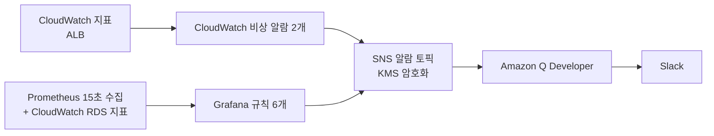

# 관측과 알림

무엇을 지켜보고 어떻게 알림을 받는지, CloudWatch와 직접 설치한 Prometheus와 Grafana를 어떻게 나눠 썼는지에 대한 기록이다.

## 1. 구성

- 관제 VPC의 Prometheus가 15초마다 호스트(node_exporter), 컨테이너(cAdvisor), 앱(`/actuator/prometheus`) 지표를 모은다. 앱 태스크는 Cloud Map 이름으로 찾는다.
- Grafana가 앱 규칙은 10초마다, RDS 규칙은 1분마다 평가한다. RDS 지표는 CloudWatch에만 있어서 Grafana가 CloudWatch 데이터 소스로 읽는다.
- CloudWatch에는 관제 서버가 죽어도 오는 비상 알람 2개와 오토스케일링이 쓰는 알람만 남겼다.
- 알림은 울릴 때와 복구될 때 모두 Slack으로 온다.

알림 경로를 정하면서 고른 것:
- SNS 토픽과 Q Developer 채널은 상시 유지하는 bootstrap에 뒀다. 운영 환경은 세션마다 지운다. 토픽을 같이 지우면 Q Developer 구독이 사라지고 다시 만들어도 살아나지 않는다.
- 토픽은 고객 관리형 KMS 키로 암호화했다. CloudWatch 알람은 AWS 관리형 키로 암호화한 토픽에 발행하지 못한다. 키 정책은 이 계정의 알람에만 사용을 허용했다.
- Q Developer API가 서울 리전에 없어 채널 설정은 us-east-2에 두고 서울 토픽을 연결했다. 채널 권한은 기본값(AdministratorAccess) 대신 CloudWatchReadOnlyAccess로 좁혔다.

## 2. 알람과 규칙

CloudWatch 비상 알람:

| 알람 | 조건 |
|---|---|
| `3tier-prod-alb-5xx-rate` | ALB와 앱 5xx를 합친 비율이 5%를 넘는 분이 5분 중 3분. 분당 요청 10건 미만은 0으로 계산 |
| `3tier-prod-alb-unhealthy-targets` | 비정상 타깃 1개 이상이 2분 연속 |

Grafana 규칙:

| 규칙 | 보는 것 | 기준 | 심각도 |
|---|---|---|---|
| AppCpuWarning | 앱 컨테이너 평균 CPU | 60% 초과 3분 | warning |
| AppCpuCritical | 앱 컨테이너 평균 CPU | 80% 초과 3분 | critical |
| AppNoScrapeTarget | 지표를 내는 앱 태스크 수 | 1 미만 30초 | critical |
| AppHttp5xxRate | 앱 5xx 비율(분당 10건 미만은 0) | 5% 초과 1분 | critical |
| RdsStorageLow | RDS 남은 저장 공간 | 2 GB 미만 | critical |
| RdsConnectionsHigh | RDS 연결 수 | 60 초과 3분 | warning |

AppNoScrapeTarget과 AppHttp5xxRate는 실험에서 드러난 탐지 공백을 메우려고 넣었다. 태스크 2개가 동시에 죽어 1분 남짓 서비스가 멈췄을 때 CloudWatch 알람이 울리지 않았다([태스크 강제 종료](troubleshooting/01-task-killed.md)). DB 연결을 끊었을 때는 Grafana 규칙이 하나도 울리지 않았다([DB 연결 차단](troubleshooting/03-db-connection-failure.md)). 5xx 규칙을 넣고 다시 시험하니 500이 나고 1분 27.7초 뒤에 알림이 나갔다.

## 3. CloudWatch와 Grafana 비교

| 기준 | CloudWatch | Prometheus와 Grafana |
|---|---|---|
| 해상도 | 1분, 평가에 쓰이기까지 약 4분 지연 | 15초 수집, 10초 평가 |
| CPU 과부하 탐지 | 6분 26초 | 4분 10초 |
| 약 65초 전체 중단 | 울리지 않음 | 약 50초 만에 Slack |
| 이 프로젝트 규모의 비용 | 더 쌈 | 관제 VPC와 서버 시간당 0.088 USD |
| 운영 부담 | 없음 | 서버, 설정, 이미지 버전 관리 |
| 관제 서버가 죽으면 | 영향 없음 | 알림 전부 중단 |

평소 탐지와 대시보드는 Grafana가 맡았다. CloudWatch에는 두 가지만 남겼다. 하나는 오토스케일링 알람이다. ECS 서비스와 용량 공급자 확장이 CloudWatch 알람으로만 동작한다. 다른 하나는 관제 서버가 죽어도 독립 경로로 오는 비상 알람 2개다.

## 4. 실측

같은 장애를 두 경로가 동시에 지켜보게 하고 같은 회차에서 비교했다(2026-11-04). 조건은 t3.small 2대, 태스크 2개, Prometheus 15초 수집, Grafana 10초 평가다. Slack까지 가는 경로는 둘 다 SNS와 Q Developer로 같다.

### 4.1 CPU 과부하

k6로 200 RPS를 목표로 부하를 줬다(실제 평균 126.6 RPS). Grafana가 CloudWatch보다 2분 16초 먼저 알렸다. CloudWatch 알람 메시지를 보니 판정에 쓴 값은 부하 초반 1분 값들이었다. 지표가 약 4분 늦게 들어와서 판정도 그만큼 늦었다.

Grafana 심각 알림(80% 3분)은 울리지 않았다. CPU가 77~100%를 오르내려 3분 연속 조건이 다섯 번 넘게 처음부터 다시 시작됐다.

### 4.2 짧은 전체 중단

태스크 2개를 동시에 멈춰 64.7초 동안 서비스가 멈췄다. 탐지 시간은 실제 중단 시작부터 쟀다. 종료 명령 뒤 약 47초 동안은 멈추는 태스크가 아직 응답했기 때문이다.

Grafana는 15초마다 수집하니 중단 17초 만에 "수집되는 앱 태스크 0개"를 감지했고, 30초 지속 조건이 34초에 찼다. CloudWatch 알람이 울리지 않은 건 1분 지표로 "5분 중 3분"이나 "2분 연속"을 보기 때문이다. 1분 남짓한 장애는 조건이 차기 전에 끝난다.

## 5. 비용 손익분기

관제 Prometheus의 활성 시계열은 6,224개였다(2026-11-05, 태스크 2개, 인스턴스 2대). 그중 대시보드와 알림 식에 실제로 쓰는 건 23개다. CloudWatch 사용자 지정 지표는 지표당 월 0.30 USD다.

| 같은 관측을 하면 | CloudWatch 월 | 직접 설치 월 |
|---|---|---|
| 화면과 알림에 쓰는 23개만 | 6.90 USD | 64.24 USD |
| 수집 전체 6,224개 | 1,867.20 USD | 64.24 USD |

손익분기는 지표 약 214개다. 세션만 켜도 양쪽 다 가동 시간에 비례해서 손익분기는 같다. 이 프로젝트 규모만 보면 CloudWatch가 9배 쌌다. 직접 설치를 고른 건 비용 때문이 아니다. 15초 해상도와 빠른 탐지, 호스트와 컨테이너와 JVM 지표를 추가 비용 없이 늘릴 수 있다는 점 때문이다. 대시보드와 알림이 200개 시계열을 넘으면 비용으로도 직접 설치가 유리해진다.

## 6. 한계와 개선 방향

겪은 문제와 한계:
- Grafana 평가 주기를 15초로 줬다가 스케줄러 기본 간격(10초)의 배수가 아니라서 Grafana가 재시작을 반복했다. 약 35분 동안 알림이 끊겼다. 평가 주기를 10초로 고쳤다.
- 메시지 템플릿 오류로 Grafana 알림이 Slack에 나타나지 않았는데, SNS 지표는 전달 성공으로 남았다. 조용한 실패였다. 템플릿을 고쳤고, 그 뒤로는 알림 경로를 바꿀 때 Slack 도착까지 보기로 했다.
- 관제 서버는 1대라 죽으면 Grafana 알림이 전부 멈춘다. 그래서 CloudWatch 비상 알람 2개를 독립 경로로 남겼다.
- Grafana 심각 알림은 80% 근처 부하에서 계속 처음부터 다시 셌다.
- 관제 VPC는 세션마다 지워서 지표는 세션 동안만 남는다.

개선 방향:
- 관제 서버에 EC2 상태 검사 알람을 걸어 SNS로 보내면 관제가 죽은 사실도 알 수 있다([EC2 상태 검사 알람](https://docs.aws.amazon.com/AWSEC2/latest/UserGuide/creating_status_check_alarms.html)).
- 심각 알림의 식을 1분 rate 대신 2~5분 평균으로 보면 된다. Grafana의 대기 기간(pending period)은 조건이 그 시간 내내 유지돼야 울리는 방식이라 값이 출렁이면 계속 처음부터 센다([Grafana 알림 평가](https://grafana.com/docs/grafana/latest/alerting/fundamentals/alert-rule-evaluation/)).
- 관제 서버를 직접 운영하는 부담을 덜려면 Amazon Managed Service for Prometheus를 쓰면 된다. 서버 관리가 없고 데이터를 여러 가용 영역에 복제한다([Amazon Managed Service for Prometheus](https://docs.aws.amazon.com/prometheus/latest/userguide/what-is-Amazon-Managed-Service-Prometheus.html)).

로그 쪽 비교는 [중앙 로그](logging.md)에 있다.
