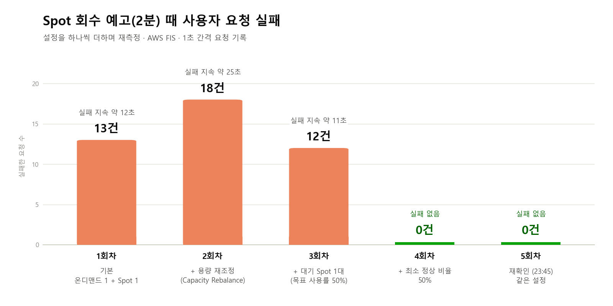
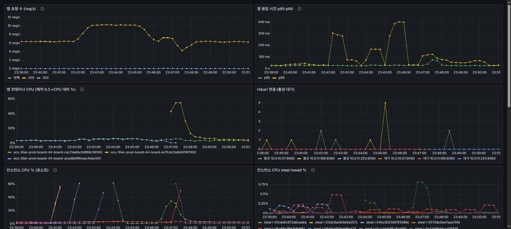

# Spot 회수

Spot 인스턴스는 싸지만 AWS가 2분 예고 뒤 회수한다. 회수가 와도 사용자 요청이 실패하지 않게 설정을 하나씩 바꿔 가며 다시 쟀다.

## 요약

2026-11-05에 쟀다. 태스크 2개 중 1개는 온디맨드 인스턴스(2a), 1개는 Spot 인스턴스(2c)에 있었다. 목표는 회수 때 사용자 요청 실패 0건이었다.

| 회차 (KST) | 더한 설정 | 대체 태스크가 정상이 되기까지 | 사용자 실패 |
|---|---|---|---|
| 1 (18:33) | 기본 | 3분 53초 | 13건 (504), 약 12초 |
| 2 (19:00) | 용량 재조정 | 2분 16초 | 18건 (504 17, 502 1), 약 25초 |
| 3 (19:39) | 대기 Spot 인스턴스 1대 | 약 2분 15초 | 12건 (502 8, 504 4), 약 11초 |
| 4 (20:27) | 최소 정상 비율 50% | 1분 22초 | 0건 |

회차별 요청 실패 건수다. 5회차는 4회차와 같은 설정으로 다시 확인한 결과다.

## 재현

회수 예고는 AWS FIS 실험 템플릿 `3tier-spot-interrupt`(`terraform/bootstrap/fis.tf`)로 보냈다. `aws:ec2:send-spot-instance-interruptions` 액션이 실행 중인 Spot 인스턴스 1대에 회수 2분 전 예고를 보낸다. 재조정 권고도 같은 순간에 같이 온다.

1. 1초마다 `/posts`와 `/actuator/health/liveness`를 요청해 기록한다.

        powershell -NoProfile -ExecutionPolicy Bypass -File scripts/probe.ps1 -Url https://3tier.link/posts,https://3tier.link/actuator/health/liveness

2. 실험을 시작한다. 템플릿 ID는 bootstrap 출력 `fis_spot_interrupt_template_id`에 있다.

        aws fis start-experiment --experiment-template-id <ID> --profile 3tier

3. 대체 태스크가 정상이 될 때까지 서비스 이벤트와 타깃 상태를 본다.

템플릿은 Spot 인스턴스 중 하나를 고르므로 태스크가 없는 대기 인스턴스가 걸릴 수도 있다.

## 무슨 일이 있었나

1회차와 2회차는 새 인스턴스를 띄우고, 이미지를 받고, 앱을 기동하는 데 2분을 넘겼다. 그 사이에 인스턴스가 회수돼 504가 났다. 2회차에 켠 용량 재조정은 효과가 없었다. 재조정 권고가 회수 예고와 같은 순간에 와서 미리 움직일 시간이 없었다.

3회차에는 대기 인스턴스를 1대 두었다. 대체 태스크는 대기 인스턴스에서 1분 7초 만에 시작했는데도 실패가 12건 났다.

4회차에는 예고 25초 뒤 옛 태스크가 멈추고 대상 그룹에서 빠졌다(등록 해제 지연 30초). 그동안 온디맨드 태스크가 요청을 모두 받았고, 대체 태스크는 1분 22초 만에 정상이 됐다. 같은 세션에 대기 인스턴스가 회수된 경우도 두 번(20:14, 20:25) 있었는데 둘 다 실패 0건이었다. 이 세션 전체 요청 2,010건 중 실패는 0건이었다.

## 원인

마지막까지 남은 원인은 최소 정상 비율 100%였다. 3회차에서 대체 태스크는 일찍 떴지만, 최소 정상 비율이 100%라 ECS가 대체 태스크가 정상이 될 때까지 옛 태스크를 대상 그룹에 남겨 뒀다. 그 사이 2분이 지나 인스턴스가 회수됐다.

최소 정상 비율을 50%로 낮추자 ECS가 옛 태스크를 먼저 빼고 대체 태스크를 올렸다. 회수 전에 요청이 온디맨드 태스크로 넘어가서 실패가 사라졌다.

## 조치와 재발 방지

최종 설정은 이렇다([DEC-67](../adr/0067-spot-capacity-mix.md)).
- 용량 공급자 전략: 온디맨드 `base=1, weight=0`, Spot `weight=1`. Spot이 모두 회수돼도 온디맨드 태스크 1개는 남는다.
- Spot ASG: t3.small과 t3a.small, `price-capacity-optimized`, 용량 재조정 켬, 2c 서브넷만
- Spot 용량 공급자 목표 사용률 50%로 대기 인스턴스 1대 유지
- 서비스 최소 정상 비율 50%

감수한 것도 있다. 회수나 배포 때 1~2분 동안 태스크가 1개만 남는다. 대기 인스턴스가 Spot으로 아낀 비용의 절반 가까이를 다시 쓴다([cost.md](../cost.md)).

## 다시 잰 결과

같은 날 23:45:37에 마지막 설정 그대로 한 번 더 회수 예고를 보냈다. 예고 뒤 요청 698건, 이 회차 전체 2,540건 모두 실패가 없었다.

이 회차의 Grafana 화면이다. 23:47 즈음 옛 Spot 태스크(파란 선)가 끝나고 새 태스크(노란 선)가 시작되는 동안에도 요청은 끊기지 않았다.

## 배운 점과 개선 방향

배운 점:
- 대체 서버를 미리 두는 것만으로는 실패가 사라지지 않았다. 옛 태스크를 대상 그룹에서 먼저 빼도록 최소 정상 비율을 낮추자 0건이 됐다. 용량 재조정도 권고가 회수 예고와 같은 순간에 와서 소용이 없었다. 설정을 하나씩 더하며 다시 재지 않았다면 진짜 원인을 놓쳤을 것이다.
- Spot 절감액의 절반 가까이를 대기 인스턴스가 다시 쓴다. 회수 실패를 0으로 만드는 값이다.

개선 방향:
- Spot 인스턴스 유형을 t3.small, t3a.small 두 가지에서 더 넓히고 가용 영역도 나누면 한꺼번에 회수될 위험이 줄어든다. AWS도 인스턴스 패밀리, 세대, 가용 영역을 다양하게 섞어 여러 Spot 용량 풀을 쓰라고 권한다([ECS 용량 공급자와 Spot](https://aws.amazon.com/blogs/containers/optimize-cost-for-container-workloads-with-ecs-capacity-providers-and-ec2-spot-instances/)).
- Spot 회수 실험을 한 번으로 끝내지 말고 정기적으로 돌려 설정이 바뀌어도 실패 0이 유지되는지 보는 게 맞다([REL12-BP04](https://docs.aws.amazon.com/wellarchitected/latest/reliability-pillar/rel_testing_resiliency_failure_injection_resiliency.html)).
